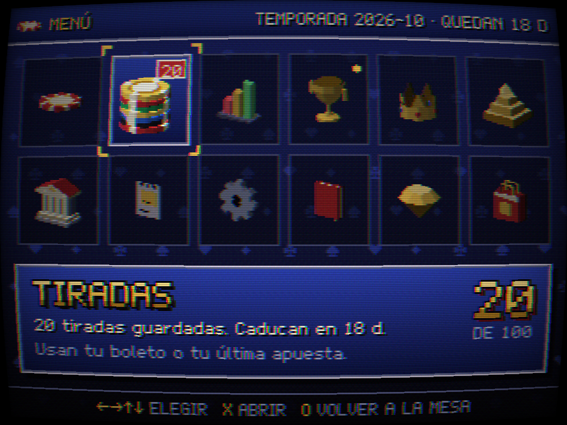
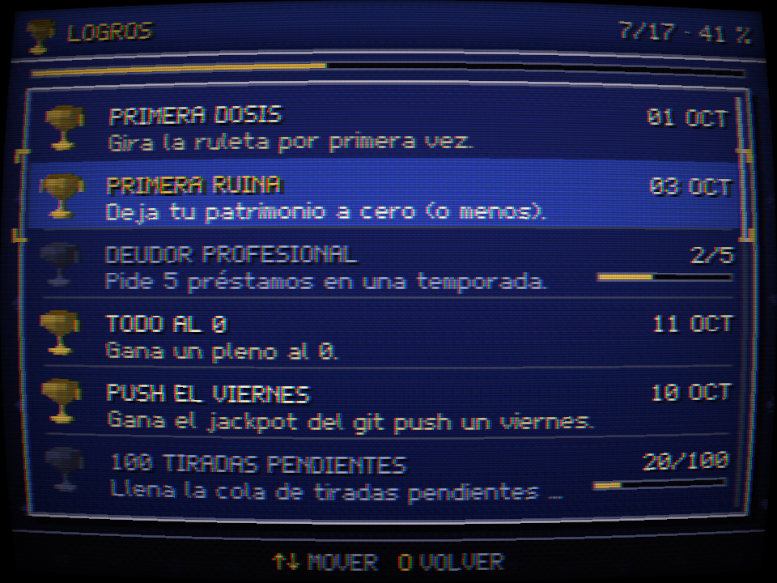

<div align="center">


### 🎰 Cada prompt es una tirada.

Una ruleta estilo PS1 que aparece mientras Claude Code piensa.<br>
Monedas de mentira, vicio de verdad (que no). Ranking mundial de los devs más arruinados.

[](https://github.com/Aimarmndz/vibe-gambling/actions/workflows/ci.yml)
[](https://github.com/Aimarmndz/vibe-gambling/releases)
[](LICENSE)
[](#instalación)
[](#monedas-de-mentira-aquí-no-se-juega-nada-de-verdad)
[](https://codespaces.new/Aimarmndz/vibe-gambling?quickstart=1)

🇬🇧 [English](README.md) · 🇪🇸 **Español**

[**vibe.aimar.dev**](https://vibe.aimar.dev) · [Instalación](#instalación) · [Cómo se juega](#cómo-se-juega) · [El espectáculo](#el-espectáculo) · [Privacidad](#privacidad) · [Tu propio casino](docs/SELF-HOSTING.md)

<br>


<sub>Un turno de verdad, sin cortes: una sesión de Claude Code con el mod cargado (izquierda) y la ventana del juego (derecha), grabadas con el mismo reloj.</sub>

</div>

## Monedas de mentira. Aquí no se juega nada de verdad.

Ni compras, ni dinero real, ni enlaces a casas de apuestas. Nunca. Las monedas son tan de verdad como los usuarios de tu side project, y lo único que te juegas es la dignidad, encima en un ranking público.

## Instalación

En una sesión de Claude Code en la terminal:

```text
/plugin install vibe-gambling --marketplace Aimarmndz/vibe-gambling
```

Claude Code te pregunta **`Add marketplace?`** por `github:Aimarmndz/vibe-gambling`: contesta `y`, elige el ámbito (el de usuario es el primero: Intro), echa un ojo a las opciones del plugin (servidor, abrir la ventana sola, idioma…; las de serie valen) y verás `Installed vibe-gambling. Plugin is now active.`

Ahora, siéntate a la mesa:

```text
/vibe-login
```

Te da un código de GitHub (`🎰 Ve a https://github.com/login/device y escribe XXXX-XXXX. Tienes 15 min; yo voy comprobando en segundo plano.`). Lo metes, autorizas y listo. Manda cualquier prompt:

1. Se abre la ventana del juego y la ruleta empieza a girar mientras Claude trabaja.
2. Cuando Claude termina, cae la bola. El resultado te llega en un aviso y el saldo, en la barra de estado (`🎰 750 🪙`).
3. Y una frase de ludópata que nadie te ha pedido. Eso es el producto.

Lo que conviene saber:

- **Nunca frena a Claude.** Todas las peticiones van en segundo plano y con 1,5 s de tope. Si el casino se cae, la barra de estado pone `🎰 sin conexión` y a seguir programando.
- **Hace falta un navegador.** Con Chrome, Chromium, Brave, Edge o Vivaldi la ventana se abre como app sin marco de 960×720; si no, en tu navegador de siempre. Linux, macOS y Windows.
- **El login de GitHub no pide ningún permiso**: solo tu perfil público.
- **¿Solo quieres cotillear?** [Prueba la demo sin conexión](https://vibe.aimar.dev/play?demo): sin cuenta, sin plugin y sin guardar nada. La ruleta gira sola; pulsa `A` para pausarla (o toca AUTO) y `G` para girar cuando quieras, como si acabaras de mandar un prompt.

## Cómo se juega

No hay botón de girar. **Tus prompts son las tiradas.** Cada turno abre una ronda; cuando Claude termina, el servidor gira la ruleta y paga (o cobra) tus apuestas.

### En directo o pendiente

- **Con la ventana abierta y a la vista** cuando Claude acaba: la tirada se juega en directo, con su bola, su drama y su frase.
- **Con la ventana cerrada o en una pestaña de fondo**: la tirada no se pierde. Se guarda como **tirada pendiente**, con el bote del `git push` y la frase de los tests fallidos de ese turno. Claude Code te avisa (`🎰 Tirada guardada · 20 pendientes. Abre /roulette y dale a GIRAR.`) y la barra de estado lleva la cuenta (`🎰 750 🪙 · 20 pendientes`).
- Al abrir la ventana te recibe con la factura. **GIRAR** (`G`, o SELECT en el mando) juega una con la animación entera. **GIRAR TODAS** las quema una detrás de otra con una animación rápida y se para sola si cae un premio gordo, si sale el verde o si te quedas sin blanca (o si pulsas ○).
- El servidor tira cada pendiente cuando la gastas, no antes, y es entonces cuando cuenta para el ranking. Caben **100** por temporada; a partir de ahí, el prompt se tira a la papelera con un chiste (_«Esto ya no es un vicio, es un backlog.»_). Caducan cuando cambia la temporada.

### Apuestas

Apuesta en la ventana (ratón, teclado o mando: flechas para moverte, ✕ para soltar ficha) o directamente desde Claude Code con `/apostar 200 rojo`. Lo que apuestas va a la tirada en curso, o a la siguiente si la bola ya está rodando.

**Casillas** para `/apostar` (o `/bet`): `rojo`, `negro`, `par`, `impar`, `falta` (1–18), `pasa` (19–36), `1a12`/`2a12`/`3a12` (o `1ª12`, también vale), `columna1`/`columna2`/`columna3`, un número (`17`) o vecinos (`8-9`, `1-2-3`, `8-9-11-12`, `1-2-3-4-5-6`). Los nombres en inglés (`red`, `1st12`, `col2`…) también entran. Las cantidades son monedas enteras o `todo`: sí, `/apostar todo rojo` funciona, y no, no es buena idea.

**Ruleta europea**: 37 casillas, el orden real del cilindro y los pagos oficiales.

| Apuesta                             | Paga |
| ----------------------------------- | ---- |
| Pleno (1 número)                    | 35:1 |
| Caballo (2)                         | 17:1 |
| Transversal (3)                     | 11:1 |
| Cuadro (4)                          | 8:1  |
| Seisena (6)                         | 5:1  |
| Docena · Columna                    | 2:1  |
| Rojo/Negro · Par/Impar · Falta/Pasa | 1:1  |

Cuando sale el 0, todas las sencillas pierden. Sin _la partage_: la casa quiere tus monedas de mentira.

### Las normas de la casa

Son los valores de la instancia oficial; todos están en [`config/game.json`](config/game.json).

- **1.000 monedas** al empezar cada temporada. Fichas de 10, 50, 100, 500, 1.000 y ALL-IN.
- **¿No has apostado?** Se repite tu última apuesta. ¿No has apostado nunca? Tu subconsciente pone 10 al rojo.
- **Ludo-Crédito Express.** ¿No te llega ni para la ficha más pequeña? La ventana te ofrece un préstamo de 1.000 monedas a una **TAE del 4.200 %**. La deuda crece un 2 % en cada tirada. Botón de devolver no hay. Letra pequeña sí, y pasa demasiado rápido para leerla.
- **Patrimonio** = saldo − deuda. Puede ser muy negativo. Esa es la gracia.
- **Bote dev.** Si en el turno hubo un `git push` que salió bien, tus ganancias se pagan **×2**. _Push to prod = bonus._
- **Tests en rojo**: frase de consuelo. ¿Cinco rojos seguidos? La ventana te recordará que ahora TIENE que salir negro. No tiene: es la falacia del jugador, y ahí está el chiste.
- **Temporadas** de un mes natural (hora de Madrid). El día 1 todo el mundo vuelve a 1.000 monedas y deuda cero. Las pendientes caducan.
- **Rankings** de cada temporada: **Arruinados** (el bueno), **Ricos** (por si alguien gana de verdad) y **Adictos** (el que más tiradas lleva). Los 10 más arruinados de cada temporada se quedan para siempre en el **Salón de la Ruina**.
- **17 logros de broma** con su aviso de trofeo de la época: _Primera ruina_, _Deudor profesional_, _Todo al 0_, _Push el viernes_, _Lo dejo cuando quiera_, _Deploy de madrugada_, _Demasiado grande para caer_…
- **Limpio, dentro de lo que cabe.** Cada resultado lo decide el servidor con `crypto.randomInt`, nunca tu navegador. La bola tarda al menos unos 4 s en caer, aunque Claude conteste en uno.

Por defecto sales en el ranking público (login, avatar y estadísticas), y te lo decimos al iniciar sesión. Con `/vibe-hide` desapareces, también del Salón de la Ruina.

### Cuatro idiomas

🇬🇧 English · 🇪🇸 Español · 🇫🇷 Français · 🇩🇪 Deutsch. Entero: el juego, la landing, la política de privacidad, los mensajes del plugin y más de 60 frases de ludópata por idioma, adaptadas y no traducidas a pelo. Las banderas son pixel art dibujado a mano. La ventana arranca en el idioma de tu navegador, el plugin en el de tu sistema, y lo cambias cuando quieras en los ajustes del juego. [Añadir un idioma](locales/README.md#resumen-en-español) es copiar una carpeta.

### Comandos

| Comando                        | Alias      | Qué hace                                                              |
| ------------------------------ | ---------- | --------------------------------------------------------------------- |
| `/roulette`                    | `/ruleta`  | Abre la ventana                                                       |
| `/bet <cantidad> <casilla>`    | `/apostar` | Apuesta a la tirada en curso o a la siguiente (`/apostar 50 17`)      |
| `/all-in [casilla]`            |            | Todo tu saldo (al rojo si no dices nada)                              |
| `/balance`                     | `/saldo`   | Saldo, deuda, patrimonio, puesto y tiradas pendientes                 |
| `/vibe-login` · `/vibe-logout` |            | Entrar con un código de GitHub · cerrar sesión                        |
| `/vibe-hide` · `/vibe-show`    |            | Ocultarte del ranking público · volver a salir                        |
| `/vibe-server [url\|default]`  |            | Ver o cambiar de servidor (para tu propio casino)                     |
| `/vibe-delete-account <login>` |            | Borra tu cuenta y todos tus datos (escribe tu login para confirmarlo) |

Las opciones del plugin (servidor, apertura automática, idioma, tiempos de espera, tamaño de la ventana) están en `/config`; detalles en [packages/mod](packages/mod/README.md#options).

## El espectáculo

Todo pasa dentro de un framebuffer de 320×240, con vértices que tiemblan, tramado, filtro CRT y sonidos sintetizados. Cada animación se puede saltar (✕, ○ o clic), tiene una versión corta y quieta con `prefers-reduced-motion` y nunca te destripa el resultado antes de que caiga la bola.

<table>
  <tr>
    <td width="50%" align="center" valign="top"><br><sub><b>MEGA WIN</b>. Las monedas son de mentira; la lluvia de fichas, low-poly.</sub></td>
    <td width="50%" align="center" valign="top"><br><sub><b>Ludo-Crédito Express</b>. Firme aquí. Y aquí. Y aquí.</sub></td>
  </tr>
</table>

Premios gordos por niveles (**BIG WIN**, **MEGA WIN**, **¡PLENO!**), la mesa entera parpadeando **¡VERDE!** cuando sale el 0, un cohete **PUSH TO PROD** antes del bote del `git push`, una pantalla de recreativa **BANCARROTA · CONTINUE? 9… 8…** que desemboca, qué casualidad, en la oferta del préstamo, rachas **ON FIRE**, el aviso de la falacia del jugador con las probabilidades de verdad y un menú principal con iconos low-poly que giran: tiradas pendientes, estadísticas, logros, ranking, memory card, banco, ajustes, cómo se juega y créditos.

<table>
  <tr>
    <td width="33%" align="center" valign="top"><a href="docs/screenshots/table.png"></a><br><sub>La mesa</sub></td>
    <td width="33%" align="center" valign="top"><a href="docs/screenshots/result.png"></a><br><sub>El resultado (y los intereses)</sub></td>
    <td width="33%" align="center" valign="top"><a href="docs/screenshots/fx-mega-3-hold.png"></a><br><sub>MEGA WIN</sub></td>
  </tr>
  <tr>
    <td width="33%" align="center" valign="top"><a href="docs/screenshots/fx-push-4-stamp.png"></a><br><sub>PUSH TO PROD ×2</sub></td>
    <td width="33%" align="center" valign="top"><a href="docs/screenshots/menu-bank.png"></a><br><sub>El banco. Devolver: no existe.</sub></td>
    <td width="33%" align="center" valign="top"><a href="docs/screenshots/fx-bankrupt-3-count.png"></a><br><sub>BANCARROTA. CONTINUE?</sub></td>
  </tr>
  <tr>
    <td width="33%" align="center" valign="top"><a href="docs/screenshots/menu-main.png"></a><br><sub>Menú principal</sub></td>
    <td width="33%" align="center" valign="top"><a href="docs/screenshots/menu-achievements.png"></a><br><sub>Logros</sub></td>
    <td width="33%" align="center" valign="top"><a href="docs/screenshots/menu-stats.png"></a><br><sub>Estadísticas: la gráfica solo va hacia un lado</sub></td>
  </tr>
</table>

<details>
<summary><b>Más capturas</b></summary>
<br>

<table>
  <tr>
    <td width="33%" align="center" valign="top"><a href="docs/screenshots/menu-memory.png"></a><br><sub>Memory card</sub></td>
    <td width="33%" align="center" valign="top"><a href="docs/screenshots/settings-language.png"></a><br><sub>Selector de idioma (aquí, en francés)</sub></td>
    <td width="33%" align="center" valign="top"><a href="docs/screenshots/landing.png"></a><br><sub>La landing</sub></td>
  </tr>
  <tr>
    <td width="33%" align="center" valign="top"><a href="docs/screenshots/menu-ranking.png"></a><br><sub>Los más arruinados</sub></td>
    <td width="33%" align="center" valign="top"><a href="docs/screenshots/pending-notice.png"></a><br><sub>Hola de nuevo. Aquí tienes la factura.</sub></td>
    <td width="33%" align="center" valign="top"><a href="docs/screenshots/fx-green-2-band.png"></a><br><sub>¡VERDE! Las sencillas, a la saca.</sub></td>
  </tr>
</table>

</details>

## Privacidad

**El plugin no sabe nada de tu trabajo.** Un test intercepta cada petición que hace el plugin (los turnos, todos los comandos, el login y los caminos de error) y falla si lleva algo más.

| Se envía al servidor                                                      | No se envía nunca                                            |
| ------------------------------------------------------------------------- | ------------------------------------------------------------ |
| Un identificador de turno aleatorio                                       | Tus prompts ni las respuestas de Claude                      |
| Cuánto duró el turno                                                      | Código, diffs ni contenido de archivos                       |
| `gitPushOk`: ¿hubo un `git push` que saliera bien? (sí/no)                | Las órdenes que se ejecutaron ni lo que escupieron           |
| `testFailed`: ¿falló algún comando de tests? (sí/no)                      | Rutas ni nombres de archivos, carpetas o repos               |
| La versión del plugin y el SO genérico (`linux`/`darwin`/`win32`/`other`) | Tu usuario del sistema ni tus variables de entorno           |
| Tu token de sesión, y lo que escribes en `/apostar` y al confirmar        | El id de sesión de Claude Code ni tu token de GitHub (jamás) |

- Los dos sí/no se calculan **en tu ordenador** mirando las órdenes de Bash, que después se olvidan.
- El servidor guarda tu id, login, URL del avatar y fecha de creación de tu cuenta de GitHub (las cuentas de menos de 30 días juegan, pero salen en el ranking al cumplirlos), tus ajustes, tus partidas, préstamos y logros de mentira y el **hash** de tus tokens de sesión. No guarda la versión del plugin ni el SO (se comprueban y se tiran), ni si tu ventana está a la vista (solo en memoria mientras está conectada), ni tu IP (un minuto en memoria para el límite de peticiones; nunca en los logs).
- Sin analíticas, sin anuncios, sin cookies de seguimiento: una cookie de sesión y punto. Los datos están en un servidor de la UE.
- Lo borras todo, al momento, con `/vibe-delete-account <tu-login>`.

La política entera: [docs/PRIVACIDAD.md](docs/PRIVACIDAD.md#español) y [vibe.aimar.dev/privacy](https://vibe.aimar.dev/privacy).

## Tu propio casino

Monta uno para tu equipo: Docker Compose con Postgres (y, si quieres, un Caddy con HTTPS automático), tu propia OAuth App de GitHub y `/vibe-server https://tu.dominio` en Claude Code. Todas las normas de la casa (saldo, fichas, TAE, bote, topes, zona horaria de las temporadas) son una línea de `config/game.json`. Paso a paso: [docs/SELF-HOSTING.md](docs/SELF-HOSTING.md); el despliegue de la instancia oficial, en [docs/DESPLIEGUE.md](docs/DESPLIEGUE.md).

## Por dentro

Por fuera, un shitpost; por dentro, un monorepo de TypeScript que se deja leer: `shared` (el contrato en esquemas zod y la lógica pura de la ruleta), `server` (Fastify + WebSocket + Drizzle/Postgres, la única autoridad), `web` (Vite + Three.js con un pipeline PS1 hecho a mano) y `mod` (el plugin de Claude Code, sin dependencias).<br>
Nada configurable está escrito en el código. Cómo encaja todo: [arquitectura](docs/ARQUITECTURA.md) · [protocolo](docs/PROTOCOLO.md) · [despliegue](docs/DESPLIEGUE.md) · [decisiones](docs/DECISIONES.md).

## Versiones

Una sola versión para todo (plugin, servidor, web e imagen de Docker), con [SemVer](https://semver.org/lang/es/) y `0.x` mientras el protocolo pueda cambiar. Cada [release](https://github.com/Aimarmndz/vibe-gambling/releases) trae el plugin en zip, el servidor en tar.gz para Node.js sin Docker, un SBOM SPDX y `SHA256SUMS`, con atestaciones de procedencia que compruebas con `gh attestation verify`; la imagen multiarquitectura va a `ghcr.io/aimarmndz/vibe-gambling`. Qué ha cambiado: [CHANGELOG.md](CHANGELOG.md). Cómo se saca y se verifica una versión: [docs/RELEASING.md](docs/RELEASING.md).

## Contribuir

La casa siempre quiere más:

- **Frases de ludópata**, en cualquiera de los cuatro idiomas, en [`locales/<idioma>/phrases.json`](locales/README.md) o con la plantilla de issue _New funny phrase_. Humor sobre la ludopatía de mentira y la cultura dev; nunca sobre personas, colectivos ni la adicción real de nadie.
- **Idiomas**: copia `locales/en`, tradúcelo y dibuja la bandera en pixel art. [Paso a paso](locales/README.md#add-a-language).
- **Shaders** y todo lo que lo haga parecer más de 1997.

Antes de nada, lee [CONTRIBUTING.md](CONTRIBUTING.md#resumen-en-español). Cada commit lleva su `Signed-off-by` ([DCO](https://developercertificate.org/), `git commit -s`). Buen rollo: [código de conducta](CODE_OF_CONDUCT.md). Los fallos de seguridad van por [SECURITY.md](SECURITY.md), nunca en issues públicas.

[](https://codespaces.new/Aimarmndz/vibe-gambling?quickstart=1)

El devcontainer (Codespaces o Dev Containers de VS Code) viene con Node, pnpm, Docker y los navegadores de Playwright listos.

## Más de Aimar

Esto es la broma. Esto no:

- **[scan2nas](https://github.com/Aimarmndz/scan2nas)**: escaneo de documentos por perfiles para escáneres Epson en Linux, directo a tu NAS (CLI + app Qt).

Más en [github.com/Aimarmndz](https://github.com/Aimarmndz).

## Créditos y licencia

Hecho por **Aimar** ([github.com/Aimarmndz](https://github.com/Aimarmndz)). El logo, las texturas, los modelos, las banderas y los sonidos están hechos para el proyecto, en código; la fuente bitmap (Polygone 12) está dibujada a mano y es OFL. Detalles en [ASSETS.md](ASSETS.md). Hecho con [Three.js](https://threejs.org/), [Fastify](https://fastify.dev/), [Drizzle](https://orm.drizzle.team/) y [zod](https://zod.dev/).

Licencia **GNU AGPL-3.0-or-later** con un término adicional del apartado 7(b): las versiones modificadas tienen que conservar la atribución "Created by Aimar (github.com/Aimarmndz)" en el pie y en la pantalla de arranque. Ver [LICENSE](LICENSE).

### Marcas

**Sin relación con Anthropic ni con Sony Interactive Entertainment.** "Claude", "Claude Code", "PlayStation" y "PS1" se mencionan solo para describir qué es esto (un plugin para Claude Code con gráficos estilo PS1); son marcas de sus dueños. La consola de la pantalla de arranque es inventada.

<sub>Si el juego deja de ser una broma para ti o para alguien cercano, hay ayuda de verdad: [jugarbien.es](https://www.jugarbien.es/) · [FEJAR](https://www.fejar.org/).</sub>
