<div align="center">

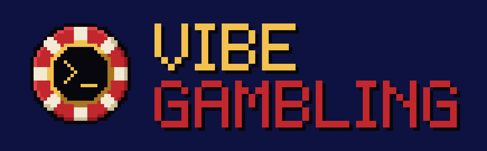

### 🎰 Every prompt is a spin.

A PS1-style roulette that pops up while Claude Code thinks.<br>
Fake coins, real addiction (not really). Global leaderboard of the most broke devs.

[](https://github.com/Aimarmndz/vibe-gambling/actions/workflows/ci.yml)
[](https://github.com/Aimarmndz/vibe-gambling/releases)
[](LICENSE)
[](#install)
[](#fake-coins-only-nothing-real-is-gambled)
[](https://codespaces.new/Aimarmndz/vibe-gambling?quickstart=1)

🇬🇧 **English** · 🇪🇸 [Español](README.es.md)

[**vibe.aimar.dev**](https://vibe.aimar.dev) · [Install](#install) · [How to play](#how-to-play) · [The show](#the-show) · [Privacy](#privacy) · [Self-hosting](docs/SELF-HOSTING.md)

<br>

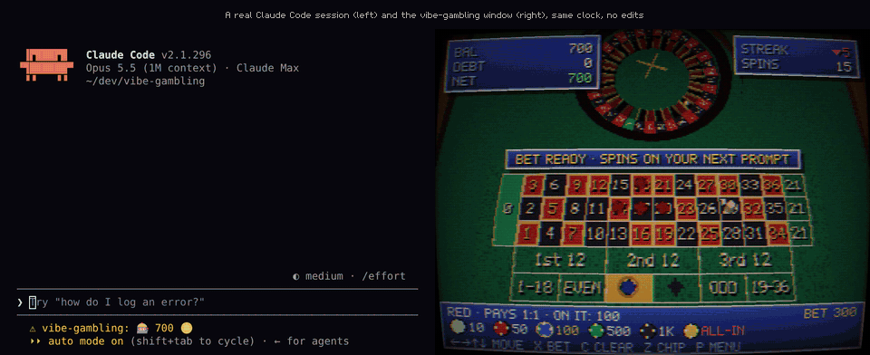

<sub>One real turn, unedited: a live Claude Code session with the mod loaded (left) and the game window (right), recorded on the same clock.</sub>

</div>

## Fake coins only. Nothing real is gambled.

No purchases, no real money, no links to betting sites. Ever. The coins are as real as the users of your vibe-coded MVP, and the only thing you can lose is your dignity on a public leaderboard.

## Install

In a Claude Code terminal session:

```text
/plugin install vibe-gambling --marketplace Aimarmndz/vibe-gambling
```

Claude Code asks **`Add marketplace?`** for `github:Aimarmndz/vibe-gambling`: answer `y`, pick the scope (user scope is the first one: press Enter), skim the plugin options (server, auto-open, language… the defaults are fine) and you get `Installed vibe-gambling. Plugin is now active.`

Then take a seat at the table:

```text
/vibe-login
```

It prints a GitHub device code (`🎰 Go to https://github.com/login/device and enter XXXX-XXXX. You have 15 min; I'll keep checking in the background.`). Enter it, authorize, done. Now send any prompt:

1. The game window pops up and the wheel starts spinning while Claude works.
2. When Claude finishes, the ball drops. You get the result in a toast and your balance in the status line (`🎰 750 🪙`).
3. You get a gambler phrase you did not ask for. That is the product.

Good to know:

- **It never slows Claude down.** Every request runs in the background with a 1.5 s timeout. If the casino is down, the status line says `🎰 offline` and life goes on.
- **It needs a browser.** With Chrome, Chromium, Brave, Edge or Vivaldi the window opens as a borderless 960×720 app; otherwise, in your default browser. Linux, macOS and Windows.
- **The GitHub login asks for no permissions**: just your public profile.
- **Just looking?** [Try the offline demo](https://vibe.aimar.dev/play?demo): no account, no plugin, nothing saved. The wheel spins by itself.

## How to play

There is no spin button. **Your prompts are the spins.** Every turn opens a round; when Claude finishes, the server spins the wheel and settles your bets.

### Live or pending

- **Window open and visible** when Claude finishes: the spin plays live, with the ball, the drama and the phrase.
- **Window closed, or in a background tab**: the spin is not wasted. It is saved as a **pending spin**, together with that turn's `git push` jackpot and failed-test phrase. Claude Code tells you (`🎰 Spin saved for later · 20 pending`) and the status line keeps count (`🎰 750 🪙 · 20 pending`).
- Open the window and it greets you with the bill. **SPIN** (`G`, or SELECT on a gamepad) plays one with the full animation. **SPIN ALL** burns through them back to back with a quick animation and stops by itself on a big win, on green or when you go broke (or when you press ○).
- The server rolls each pending spin when you spend it, not before, and that is when it counts for the leaderboard. Up to **100** per season; past that, the prompt is dropped with a joke (_"This is not a habit anymore, it is a backlog."_). They expire when the season ends.

### Betting

Bet in the window (mouse, keyboard or gamepad: arrows to move, ✕ to drop a chip) or straight from Claude Code with `/bet 200 red`. Your bets ride on the current spin, or on the next one if the ball is already rolling.

**Squares** for `/bet`: `red`/`rojo`, `black`/`negro`, `even`/`par`, `odd`/`impar`, `low`/`1-18`, `high`/`19-36`, `1st12`/`2nd12`/`3rd12`, `col1`/`col2`/`col3`, a number (`17`) or neighbours (`8-9`, `1-2-3`, `8-9-11-12`, `1-2-3-4-5-6`). Amounts are whole fake coins or `all-in`.

**European roulette**: 37 pockets, real wheel order, official payouts.

| Bet                               | Pays |
| --------------------------------- | ---- |
| Straight (1 number)               | 35:1 |
| Split (2)                         | 17:1 |
| Street (3)                        | 11:1 |
| Corner (4)                        | 8:1  |
| Six line (6)                      | 5:1  |
| Dozen · Column                    | 2:1  |
| Red/Black · Even/Odd · 1–18/19–36 | 1:1  |

When the 0 comes up, every even-money bet loses. No _la partage_: the house wants your fake money.

### House rules

Defaults of the official instance; all of them live in [`config/game.json`](config/game.json).

- **1,000 coins** at the start of each season. Chips: 10, 50, 100, 500, 1,000 and ALL-IN.
- **Didn't bet?** Your last bet is repeated. Never bet at all? Your subconscious puts 10 on red.
- **Ludo-Credit Express.** Can't afford the smallest chip? The window offers a 1,000-coin loan at a **4,200 % APR**. The debt grows 2 % with every spin. There is no repay button. There is fine print, and it scrolls too fast to read.
- **Net worth** = balance − debt. It can go very negative. That is the point.
- **Dev jackpot.** If a `git push` succeeded during the turn, your winnings pay **×2**. _Push to prod = bonus._
- **Failed tests** get a consolation phrase. Five reds in a row? The window will remind you that black HAS to come up now. It doesn't: that is the gambler's fallacy, and that is the joke.
- **Seasons** are calendar months (Europe/Madrid). On the 1st, everyone goes back to 1,000 coins and zero debt. Pending spins expire.
- **Leaderboards** per season: **Most broke** (the star one), **Richest** (in case someone actually wins) and **Most spins** (the most hooked). The 10 most broke devs of every season are kept forever in the **Hall of Ruin**.
- **17 joke achievements** with a period-correct trophy pop-up: _First ruin_, _Professional debtor_, _All on zero_, _Push on Friday_, _I can quit anytime_, _3 a.m. deploy_, _Too big to fail_…
- **Fair, as far as fake gambling goes.** The server decides every result with `crypto.randomInt`, never your browser. The ball takes at least ~4 s to drop, even if Claude answers in one.

You show up on the public leaderboard by default (login, avatar and stats), and you are told so when you log in. `/vibe-hide` makes you vanish, Hall of Ruin included.

### Four languages

🇬🇧 English · 🇪🇸 Español · 🇫🇷 Français · 🇩🇪 Deutsch. All of it: the game, the landing page, the privacy policy, the plugin messages and 60+ gambler phrases per language, adapted rather than translated. The flags are hand-drawn pixel art. The window starts in your browser's language, the plugin in your system's, and you can switch from the in-game settings. [Adding a language](locales/README.md) is copying a folder.

### Commands

| Command                        | Alias      | What it does                                                         |
| ------------------------------ | ---------- | -------------------------------------------------------------------- |
| `/roulette`                    | `/ruleta`  | Open the window                                                      |
| `/bet <amount> <square>`       | `/apostar` | Bet on the current or next spin (`/bet 200 red`, `/apostar 50 17`)   |
| `/all-in [square]`             |            | Your whole balance (red by default)                                  |
| `/balance`                     | `/saldo`   | Balance, debt, net worth, rank and pending spins                     |
| `/vibe-login` · `/vibe-logout` |            | GitHub device-code login · log out                                   |
| `/vibe-hide` · `/vibe-show`    |            | Hide from / show on the public leaderboard                           |
| `/vibe-server [url\|default]`  |            | Show or change the server (self-hosting)                             |
| `/vibe-delete-account <login>` |            | Delete your account and all its data (type your login to confirm it) |

Plugin options (server, auto-open, language, timeouts, window size) are in `/config`; see [packages/mod](packages/mod/README.md#options).

## The show

Everything happens inside a 320×240 framebuffer with wobbly vertices, dithering and a CRT filter, with synthesized sounds. Every animation can be skipped (✕, ○ or a click), has a short, steady version under `prefers-reduced-motion`, and never gives away the result before the ball drops.

<table>
  <tr>
    <td width="50%" align="center" valign="top">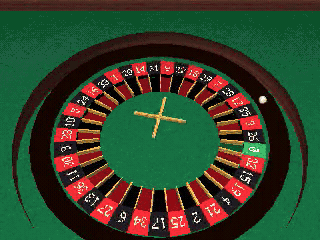<br><sub><b>MEGA WIN</b>. The coins are fake; the chip rain is low-poly.</sub></td>
    <td width="50%" align="center" valign="top">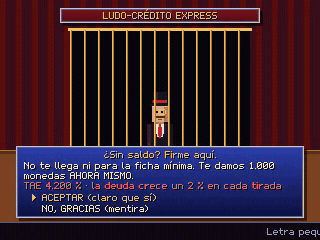<br><sub><b>Ludo-Credit Express</b>. Sign here. And here. And here.</sub></td>
  </tr>
</table>

Big wins by tiers (**BIG WIN**, **MEGA WIN**, **STRAIGHT UP!**), the table blinking **GREEN!** on a 0, a **PUSH TO PROD** rocket before a `git push` jackpot, an arcade **BANKRUPT · CONTINUE? 9… 8…** that lands, conveniently, on the loan offer, **ON FIRE** streaks, a gambler's-fallacy warning with the actual odds, and a main menu with spinning low-poly icons: pending spins, stats, achievements, leaderboard, memory card, bank, settings, how to play and credits.

<table>
  <tr>
    <td width="33%" align="center" valign="top"><a href="docs/screenshots/table.png">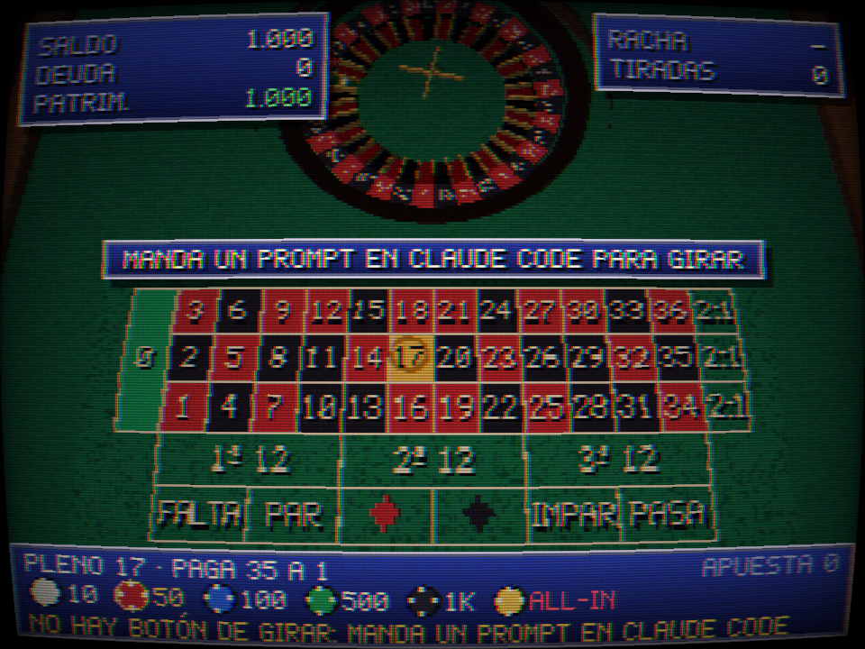</a><br><sub>The table</sub></td>
    <td width="33%" align="center" valign="top"><a href="docs/screenshots/result.png">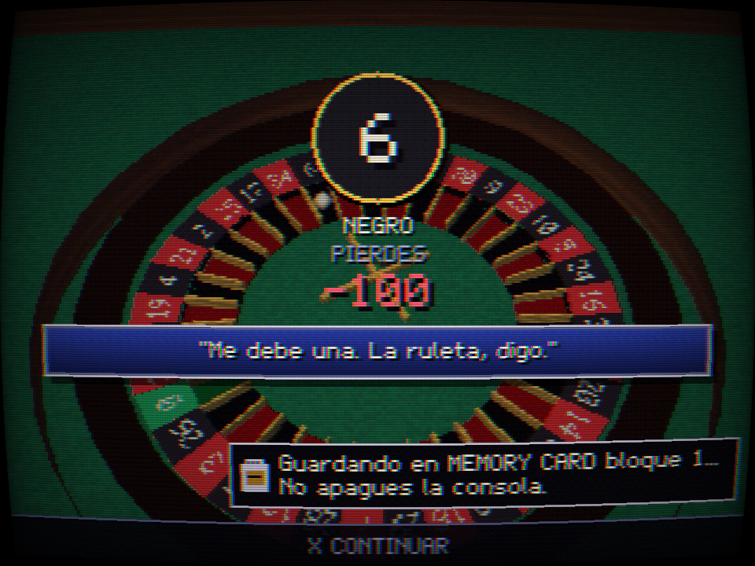</a><br><sub>The result (and the interest)</sub></td>
    <td width="33%" align="center" valign="top"><a href="docs/screenshots/fx-mega-3-hold.png">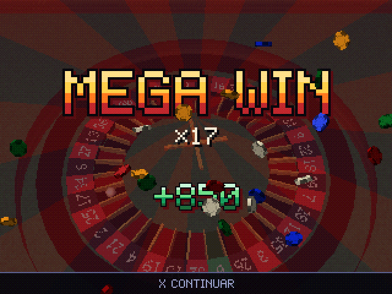</a><br><sub>MEGA WIN</sub></td>
  </tr>
  <tr>
    <td width="33%" align="center" valign="top"><a href="docs/screenshots/fx-push-4-stamp.png">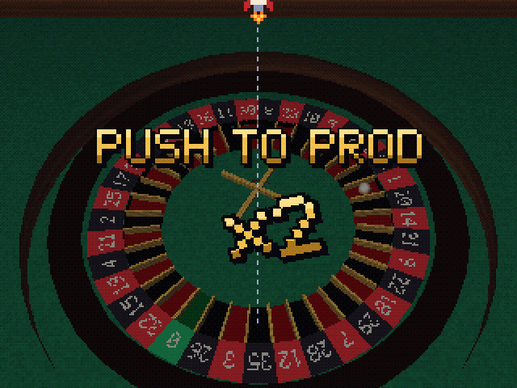</a><br><sub>PUSH TO PROD ×2</sub></td>
    <td width="33%" align="center" valign="top"><a href="docs/screenshots/menu-bank.png">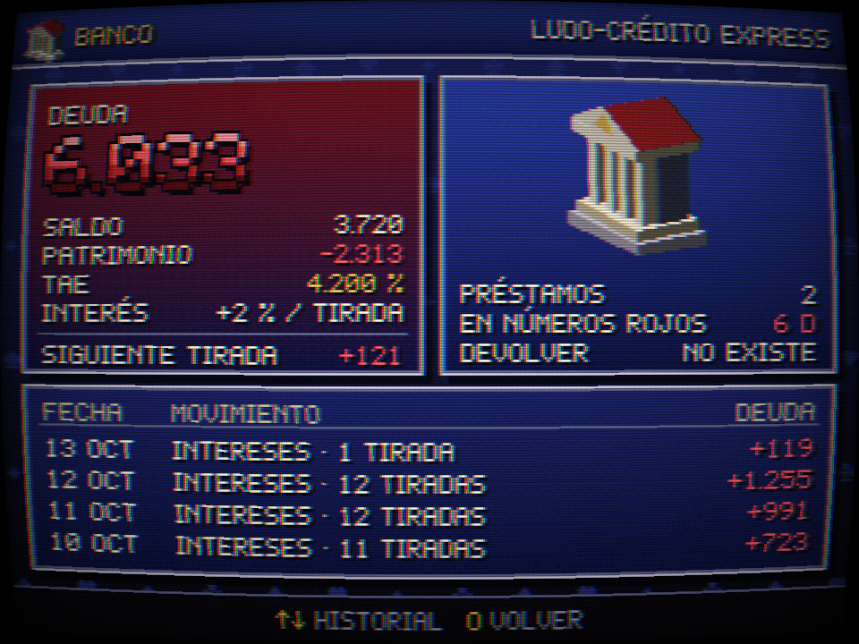</a><br><sub>The bank. Repay: does not exist.</sub></td>
    <td width="33%" align="center" valign="top"><a href="docs/screenshots/fx-bankrupt-3-count.png">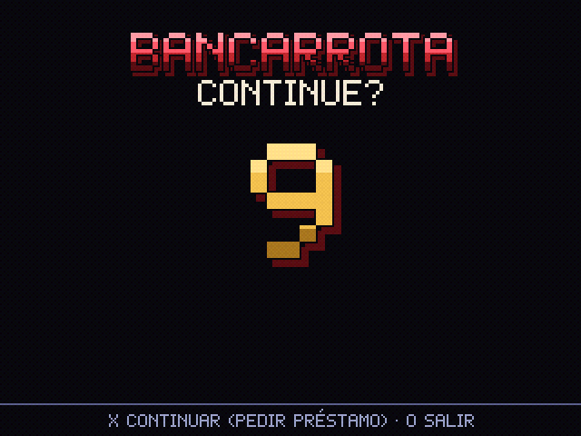</a><br><sub>BANKRUPT. CONTINUE?</sub></td>
  </tr>
  <tr>
    <td width="33%" align="center" valign="top"><a href="docs/screenshots/menu-main-en.png">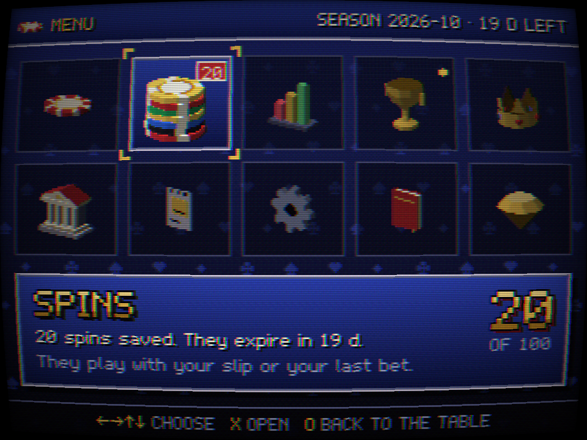</a><br><sub>Main menu</sub></td>
    <td width="33%" align="center" valign="top"><a href="docs/screenshots/menu-achievements-en.png">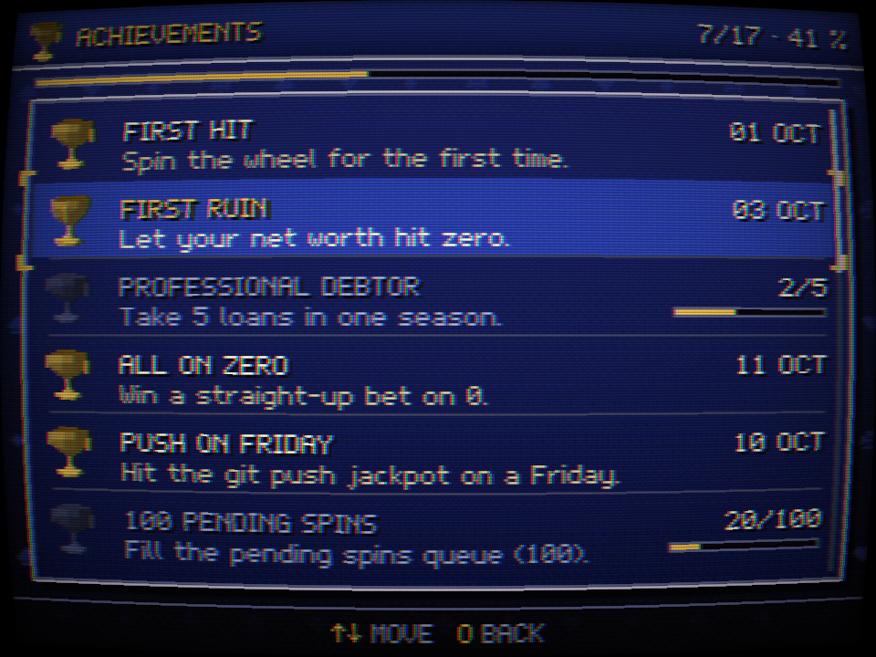</a><br><sub>Achievements</sub></td>
    <td width="33%" align="center" valign="top"><a href="docs/screenshots/menu-stats.png">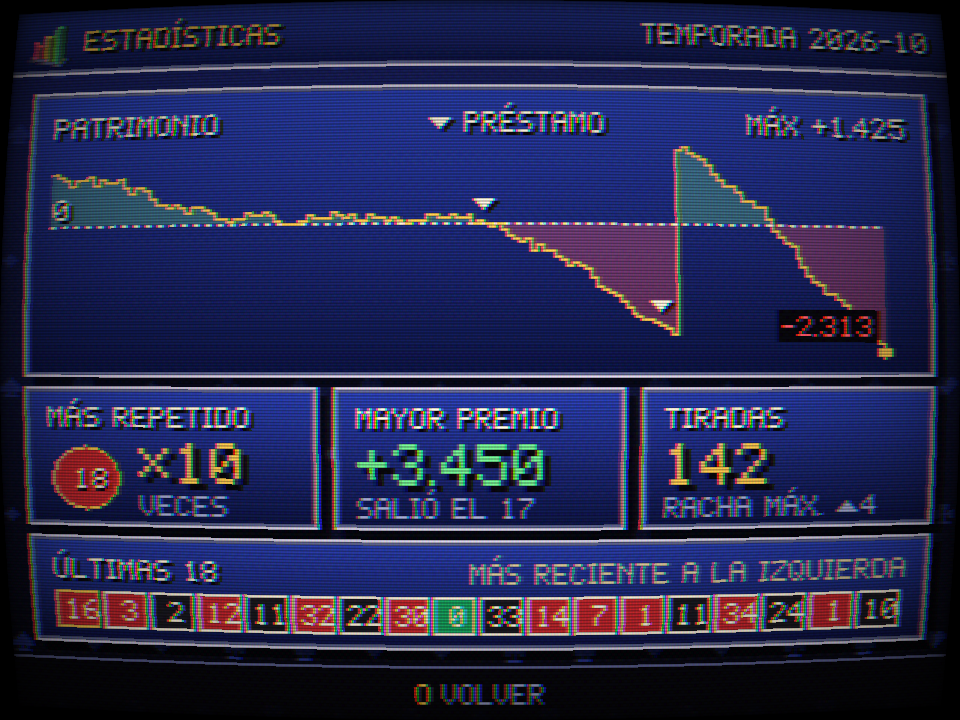</a><br><sub>Stats: the chart only goes one way</sub></td>
  </tr>
</table>

<details>
<summary><b>More screenshots</b></summary>
<br>

<table>
  <tr>
    <td width="33%" align="center" valign="top"><a href="docs/screenshots/menu-memory.png">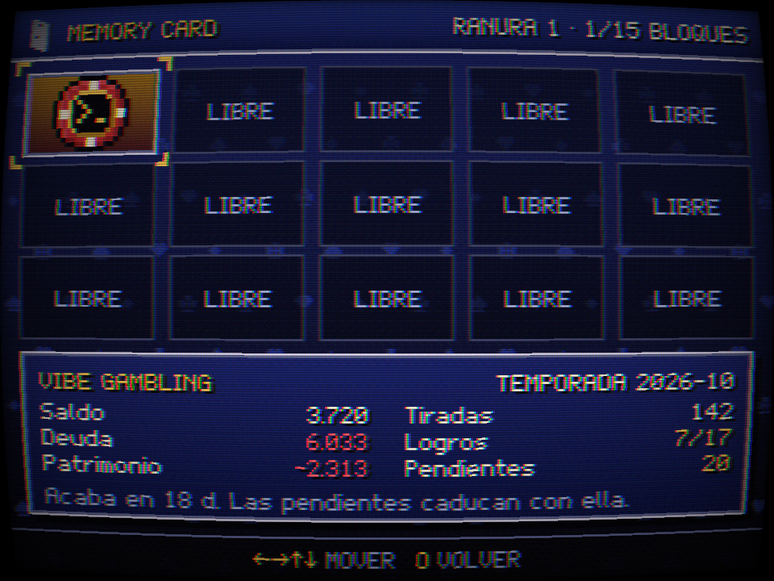</a><br><sub>Memory card</sub></td>
    <td width="33%" align="center" valign="top"><a href="docs/screenshots/settings-language.png">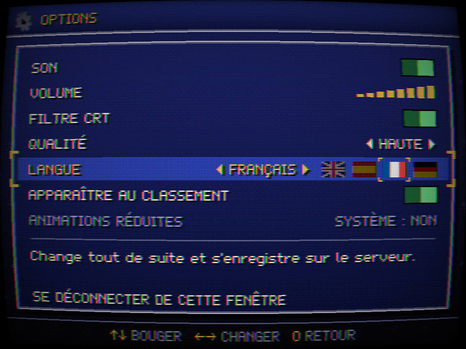</a><br><sub>Language picker (here, in French)</sub></td>
    <td width="33%" align="center" valign="top"><a href="docs/screenshots/landing.png">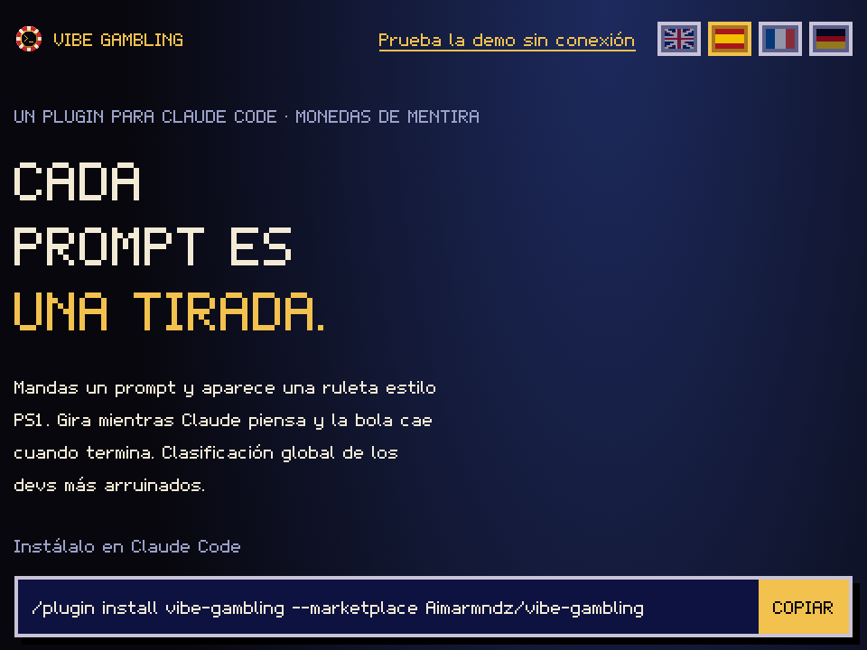</a><br><sub>The landing page</sub></td>
  </tr>
  <tr>
    <td width="33%" align="center" valign="top"><a href="docs/screenshots/menu-ranking.png">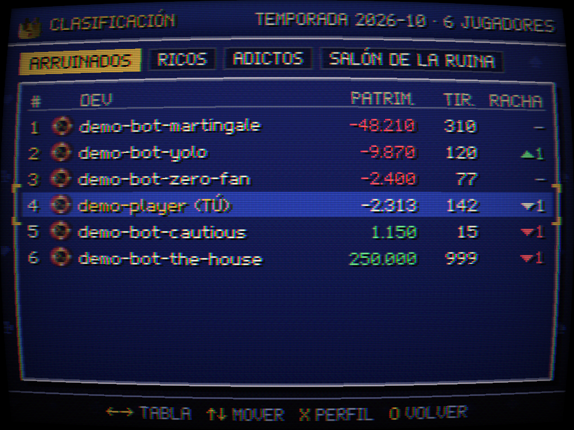</a><br><sub>Most broke devs</sub></td>
    <td width="33%" align="center" valign="top"><a href="docs/screenshots/pending-notice.png">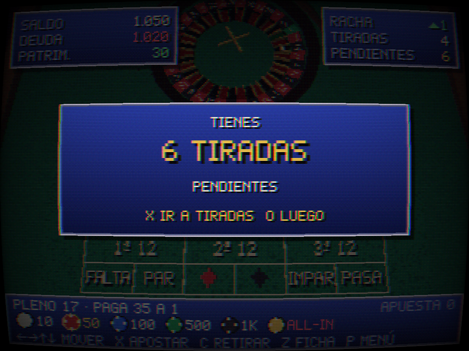</a><br><sub>Welcome back. Here is the bill.</sub></td>
    <td width="33%" align="center" valign="top"><a href="docs/screenshots/fx-green-2-band.png">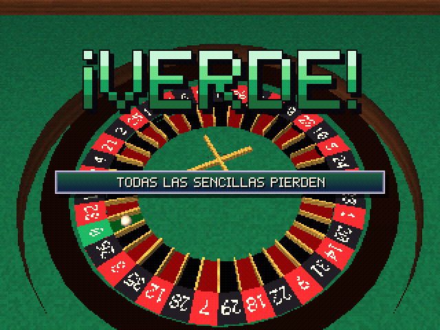</a><br><sub>GREEN! Even-money bets: gone.</sub></td>
  </tr>
</table>

</details>

## Privacy

**The plugin knows nothing about your work.** A test intercepts every request the plugin makes (turns, every command, the login and the error paths) and fails if it carries anything else.

| Sent to the server                                                | Never sent                                            |
| ----------------------------------------------------------------- | ----------------------------------------------------- |
| A random turn id                                                  | Your prompts or Claude's answers                      |
| How long the turn took                                            | Code, diffs or file contents                          |
| `gitPushOk`: did a `git push` succeed? (yes/no)                   | The commands that ran, or their output                |
| `testFailed`: did a test command fail? (yes/no)                   | Paths, file, folder or repo names                     |
| Plugin version and generic OS (`linux`/`darwin`/`win32`/`other`)  | Your system user name or environment variables        |
| Your session token, and what you type in `/bet` and confirmations | Claude Code's session id, or your GitHub token (ever) |

- The two yes/no flags are computed **on your machine** from the Bash commands, which are then forgotten.
- The server stores your GitHub id, login and avatar URL, your settings, your fake games, loans and achievements, and the **hash** of your session tokens. Not the plugin version or OS (checked and dropped), not whether your window is visible (memory only, while connected), not your IP (a minute in memory for rate limiting; never in the logs).
- No analytics, no ads, no tracking cookies: one session cookie. Data lives on a server in the EU.
- Delete everything, right now, with `/vibe-delete-account <your-login>`.

Full policy: [docs/PRIVACIDAD.md](docs/PRIVACIDAD.md#english) and [vibe.aimar.dev/privacy](https://vibe.aimar.dev/privacy).

## Self-hosting

Run your own casino for your team: Docker Compose with Postgres (and an optional Caddy with automatic HTTPS), your own GitHub OAuth App, and `/vibe-server https://your.domain` in Claude Code. Every rule of the house (balance, chips, APR, jackpot, caps, season time zone) is a line in `config/game.json`. Step by step: [docs/SELF-HOSTING.md](docs/SELF-HOSTING.md).

## Under the hood

A shitpost on the outside, a TypeScript monorepo you can read on the inside: `shared` (the contract as zod schemas and the pure roulette logic), `server` (Fastify + WebSocket + Drizzle/Postgres, the only authority), `web` (Vite + Three.js with a hand-made PS1 pipeline) and `mod` (the Claude Code plugin, no dependencies).<br>
Nothing configurable is hardcoded. How it fits together: [architecture](docs/ARQUITECTURA.md) · [protocol](docs/PROTOCOLO.md) · [deployment](docs/DESPLIEGUE.md) · [decisions](docs/DECISIONES.md) (the docs are in Spanish; the code is in English).

## Releases

One version for everything (plugin, server, web and Docker image), [SemVer](https://semver.org/), `0.x` while the protocol may still change. Each [GitHub Release](https://github.com/Aimarmndz/vibe-gambling/releases) ships the plugin as a zip, the server as a tarball for Node.js without Docker, an SPDX SBOM and `SHA256SUMS`, with build provenance you can check with `gh attestation verify`; the multi-arch image goes to `ghcr.io/aimarmndz/vibe-gambling`. What changed: [CHANGELOG.md](CHANGELOG.md). How a release is cut and verified: [docs/RELEASING.md](docs/RELEASING.md).

## Contributing

The house always wants more:

- **Gambler phrases**, in any of the four languages, in [`locales/<language>/phrases.json`](locales/README.md) or with the _New funny phrase_ issue template. Jokes about fake gambling addiction and dev culture; never about people, groups, or anyone's real addiction.
- **Languages**: copy `locales/en`, translate it, draw the flag in pixel art. [Step by step](locales/README.md#add-a-language).
- **Shaders** and anything that makes it look more like 1997.

Read [CONTRIBUTING.md](CONTRIBUTING.md) first. Every commit needs a `Signed-off-by` line ([DCO](https://developercertificate.org/), `git commit -s`). Be nice: [Code of Conduct](CODE_OF_CONDUCT.md). Security issues go through [SECURITY.md](SECURITY.md), never public issues.

[](https://codespaces.new/Aimarmndz/vibe-gambling?quickstart=1)

The dev container (Codespaces or VS Code Dev Containers) comes with Node, pnpm, Docker and the Playwright browsers ready.

## More from Aimar

This is the joke. This is not:

- **[scan2nas](https://github.com/Aimarmndz/scan2nas)**: preset-based document scanning for Epson scanners on Linux, straight to your NAS (CLI + Qt app).

More on [github.com/Aimarmndz](https://github.com/Aimarmndz).

## Credits and license

Created by **Aimar** ([github.com/Aimarmndz](https://github.com/Aimarmndz)). The logo, textures, models, flags and sounds are made for this project, in code; the bitmap font (Polygone 12) is hand-drawn and released under the OFL. Details in [ASSETS.md](ASSETS.md). Built with [Three.js](https://threejs.org/), [Fastify](https://fastify.dev/), [Drizzle](https://orm.drizzle.team/) and [zod](https://zod.dev/).

Licensed under the **GNU AGPL-3.0-or-later** with an additional term under section 7(b): modified versions must keep the attribution "Created by Aimar (github.com/Aimarmndz)" in the footer and the boot screen. See [LICENSE](LICENSE).

### Trademarks

**Not affiliated with Anthropic or Sony Interactive Entertainment.** "Claude", "Claude Code", "PlayStation" and "PS1" are mentioned only to describe what this is (a plugin for Claude Code with PS1-style graphics); they are trademarks of their owners. The console in the boot screen is made up.

<sub>If gambling stops being a joke for you or someone close to you, real help exists: [BeGambleAware](https://www.begambleaware.org/) · [GamCare](https://www.gamcare.org.uk/).</sub>
