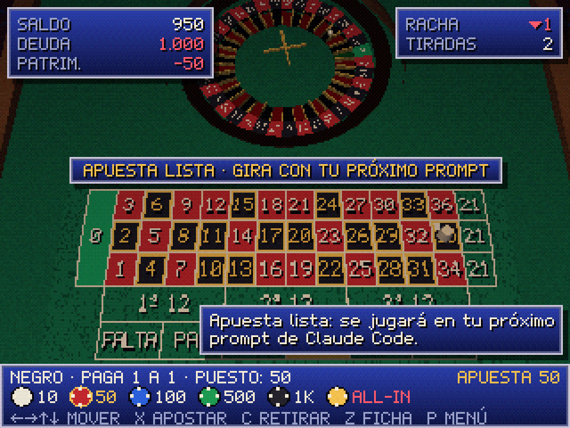
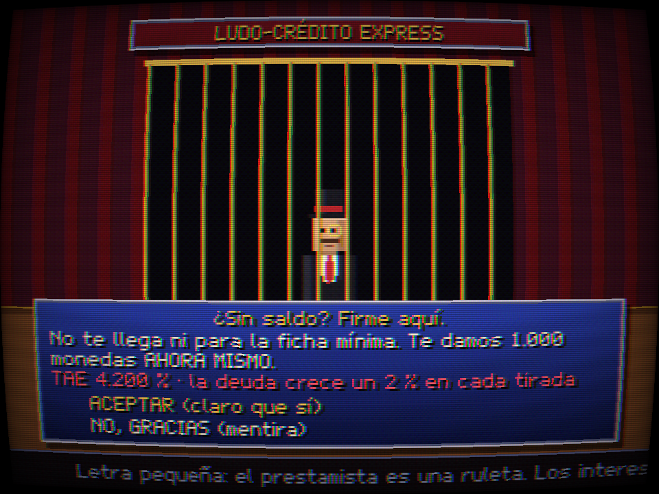
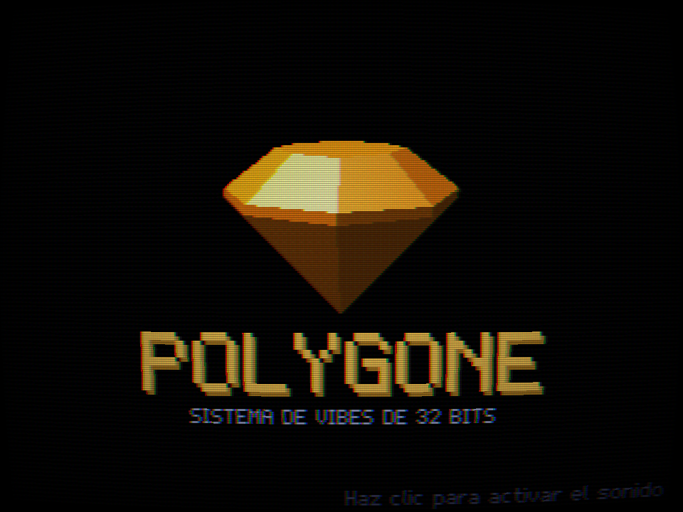
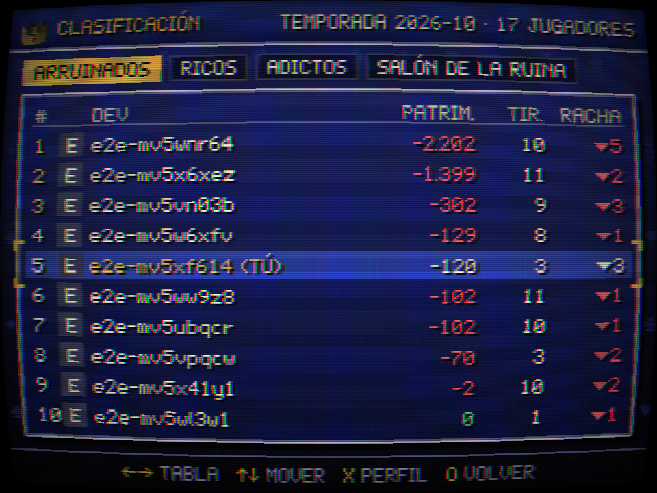
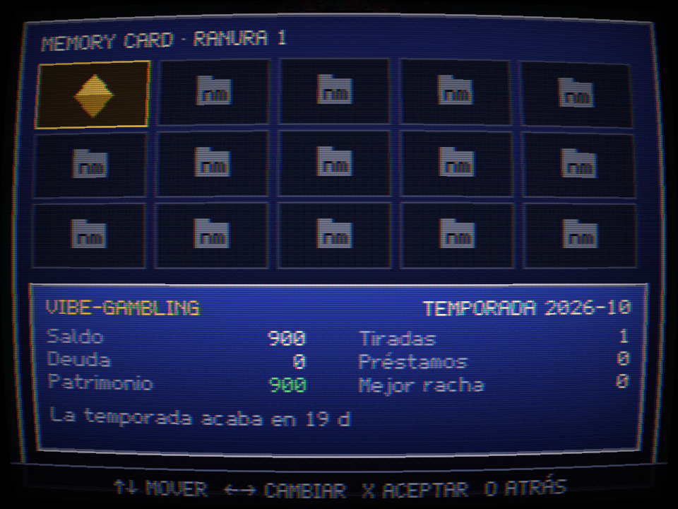

<div align="center">

# vibe-gambling

**🎰 Every prompt is a spin.** A PS1-style roulette that pops up while Claude Code thinks.<br/>
Fake coins, real addiction (not really). Global leaderboard of the most broke devs.

[](https://github.com/Aimarmndz/vibe-gambling/actions/workflows/ci.yml)
[](LICENSE)
[](https://github.com/Aimarmndz/vibe-gambling/releases)

[**vibe.aimar.dev**](https://vibe.aimar.dev) · [Install](#install) · [How to play](#how-to-play) · [Privacy](#privacy) · [Self-hosting](docs/SELF-HOSTING.md) · [Español](#español)

<!-- GIF de la ruleta girando mientras Claude Code trabaja: lo graba el orquestador en docs/demo.gif -->


</div>

<h2 align="center">Fake coins only. Nothing real is gambled.</h2>

<p align="center">No purchases, no real money, no links to betting sites. Ever. The coins are as real as your vibe-coded MVP's users.</p>

| The table                                                                         | The result                                                                               | The loan shark                                                                  |
| --------------------------------------------------------------------------------- | ---------------------------------------------------------------------------------------- | ------------------------------------------------------------------------------- |
|  |  |  |
| **Boot screen**                                                                   | **Leaderboard**                                                                          | **Memory card**                                                                 |
|                             |                        |                   |

## Install

In a Claude Code terminal session:

```text
/plugin install vibe-gambling --marketplace Aimarmndz/vibe-gambling
```

Claude Code asks **`Add marketplace?`** for `github:Aimarmndz/vibe-gambling`: answer `y`. Then pick the scope (user scope is the first one: press Enter), review the plugin options (server, auto-open, language… the defaults are fine) and you get `Installed vibe-gambling. Plugin is now active.`

Then take a seat at the table:

```text
/vibe-login
```

It shows a GitHub device code (`🎰 Go to https://github.com/login/device and enter XXXX-XXXX. You have 15 min; I'll keep checking in the background.`). Enter it, authorize, and you're in. Send any prompt: the window opens and the wheel starts spinning while Claude works. When Claude finishes, the ball drops.

- Needs a browser. With Chrome, Chromium, Brave, Edge or Vivaldi the window opens as a borderless app (960×720); otherwise in your default browser.
- Linux, macOS and Windows. The plugin has no dependencies and never slows a turn down: every request runs in the background with a 1.5 s timeout, and if the casino is down you only see `🎰 offline` in the status line.
- The GitHub login asks for **no permissions**: only your public profile.

## How to play

There is no spin button. **Your prompts are the spins.** Each turn opens a round; when Claude finishes, the server spins the wheel and settles your bets. You can bet in the window (mouse, keyboard or gamepad) or from Claude Code.

| Command                        | Alias      | What it does                                                                |
| ------------------------------ | ---------- | --------------------------------------------------------------------------- |
| `/roulette`                    | `/ruleta`  | Open the window                                                             |
| `/bet <amount> <square>`       | `/apostar` | Bet on the current spin, or the next one (`/bet 200 red`, `/apostar 50 17`) |
| `/all-in [square]`             |            | Your whole balance (red by default)                                         |
| `/balance`                     | `/saldo`   | Balance, debt, net worth and rank                                           |
| `/vibe-login` · `/vibe-logout` |            | GitHub device-code login · log out                                          |
| `/vibe-hide` · `/vibe-show`    |            | Hide from / show on the public leaderboard                                  |
| `/vibe-server [url\|default]`  |            | Show or change the server (self-hosting)                                    |
| `/vibe-delete-account <login>` |            | Delete your account and all its data                                        |

**Squares** for `/bet`: `red`/`rojo`, `black`/`negro`, `even`/`par`, `odd`/`impar`, `low`/`1-18`, `high`/`19-36`, `1st12`/`2nd12`/`3rd12`, `col1`/`col2`/`col3`, a number (`17`) or neighbours (`8-9`, `1-2-3`, `8-9-11-12`, `1-2-3-4-5-6`). Amounts are whole fake coins or `all-in`.

**European roulette** (37 pockets, real wheel order), official payouts:

| Bet                               | Pays |
| --------------------------------- | ---- |
| Straight (1 number)               | 35:1 |
| Split (2)                         | 17:1 |
| Street (3)                        | 11:1 |
| Corner (4)                        | 8:1  |
| Six line (6)                      | 5:1  |
| Dozen · Column                    | 2:1  |
| Red/Black · Even/Odd · 1–18/19–36 | 1:1  |

With a 0, every even-money bet loses (no _la partage_: the house wants your fake money).

**The rules of the house** (defaults of the official instance, all in [`config/game.json`](config/game.json)):

- You start each season with **1,000 coins**. Chips: 10, 50, 100, 500, 1,000 and ALL-IN.
- **Didn't bet?** Your last bet is repeated. Never bet? Your subconscious puts 10 on red.
- **Ludo-Credit Express**: broke? The window offers a 1,000-coin loan at a **4,200 % APR**. The debt grows 2 % with every spin. Unlimited loans. Read the fine print.
- **Net worth** = balance − debt. It can go very negative. That's the point.
- **Dev jackpot**: if a `git push` succeeded during the turn, your winnings pay **×2**. _Push to prod = bonus._
- A failed test command gets you a consolation phrase. Five reds in a row? The window will remind you that black HAS to come up now (it doesn't: that's the gambler's fallacy, and that's the joke).
- **Seasons** are calendar months (Europe/Madrid). On the 1st, everyone goes back to 1,000 coins and zero debt.
- **Leaderboards** per season: **Most broke** (the star one), **Richest** (in case someone actually wins) and **Most spins** (the most addicted). The top 10 broke devs of every season are kept forever in the **Hall of Ruin**.
- The ball always takes at least ~4 s to drop, even if Claude answers in one. The result is decided by the server (`crypto.randomInt`), never by your browser.

You appear on the public leaderboard by default (login, avatar and stats), and you're told so when you log in. `/vibe-hide` makes you vanish, Hall of Ruin included.

## Privacy

**The plugin knows nothing about your work.** This is enforced by a test that intercepts every request the plugin makes and fails if it carries anything else.

| Sent to the server                                       | Never sent                                                 |
| -------------------------------------------------------- | ---------------------------------------------------------- |
| A random turn id                                         | Your prompts or Claude's answers                           |
| How long the turn took                                   | Code, diffs or file contents                               |
| `gitPushOk`: did a `git push` succeed? (yes/no)          | The commands that ran, or their output                     |
| `testFailed`: did a test command fail? (yes/no)          | Paths, file names, folder or repo names                    |
| Plugin version and generic OS (`linux`/`darwin`/`win32`) | Your user name, environment variables, Claude's session id |
| Your session token                                       | Your GitHub token (the server throws it away after login)  |

The two yes/no flags are computed **on your machine** from the Bash commands, which are then forgotten. The server stores your GitHub id, login and avatar, your fake games and the hash of your session tokens. No analytics, no ads, no tracking cookies: one session cookie. Your IP is not stored and never written to logs. Data lives on a server in the EU.

Delete everything with `/vibe-delete-account <your-login>`. Full policy: [docs/PRIVACIDAD.md](docs/PRIVACIDAD.md) (EN/ES) and [vibe.aimar.dev/privacy](https://vibe.aimar.dev/privacy).

## Self-hosting

Run your own casino for your team: Docker Compose with Postgres and an optional Caddy with automatic HTTPS, your own GitHub OAuth App, and `/vibe-server https://your.domain` in Claude Code. See [docs/SELF-HOSTING.md](docs/SELF-HOSTING.md).

## Under the hood

A shitpost on the outside; on the inside, a TypeScript monorepo you can read:

- **`packages/shared`**: the contract. Every HTTP and WebSocket message is a zod schema, validated on both ends; pure roulette logic with ≥ 95 % coverage and property tests (fast-check).
- **`packages/server`**: Fastify + WebSocket + Drizzle/Postgres. The only authority: crypto RNG, money operations in transactions with row locks (tested with 150 concurrent bets), idempotent turns, GitHub Device Flow brokered by the server, monthly seasons with a DB-locked job, strict CSP, rate limits, logs without personal data.
- **`packages/web`**: Vite + Three.js with a hand-made PS1 pipeline: 320×240 framebuffer, vertex snapping, affine texture warping, 15-bit color with dithering, fog, CRT filter, an invented boot screen and memory card, synthesized sounds. Respects `prefers-reduced-motion`.
- **`packages/mod`**: the Claude Code plugin. No dependencies, never blocks a turn, tested on Linux, macOS and Windows.
- Nothing configurable is hardcoded: environment variables and `config/*.json`, validated at startup.

Docs: [architecture](docs/ARQUITECTURA.md) · [protocol](docs/PROTOCOLO.md) (generated and checked from the schemas) · [deployment](docs/DESPLIEGUE.md) · [decisions](docs/DECISIONES.md). (The docs are in Spanish; the code is in English.)

## Contributing

Contributions welcome, especially:

- **New gambler phrases** (English and Spanish) in [`packages/shared/src/i18n`](packages/shared/src/i18n), or with the _New funny phrase_ issue template. Jokes about fake gambling addiction and dev culture; never about real people or anyone's real addiction.
- **Translations** of the window and the plugin.
- **Shaders** and anything that makes it look more like 1997.

Read [CONTRIBUTING.md](CONTRIBUTING.md) first. Every commit needs a `Signed-off-by` line ([DCO](https://developercertificate.org/), `git commit -s`). Be nice: [Code of Conduct](CODE_OF_CONDUCT.md). Security issues go through [SECURITY.md](SECURITY.md), never public issues.

## Releases

One version for everything (plugin, server, web and Docker image), following [SemVer](https://semver.org/); `0.x` while the protocol may still change. Each [GitHub Release](https://github.com/Aimarmndz/vibe-gambling/releases) ships the plugin as a zip, the server as a tarball for Node.js without Docker, an SPDX SBOM and `SHA256SUMS`, with build provenance attestations you can check with `gh attestation verify`; the multi-arch image goes to `ghcr.io/aimarmndz/vibe-gambling`. What changed: [CHANGELOG.md](CHANGELOG.md). How a release is cut and verified: [docs/RELEASING.md](docs/RELEASING.md).

## More from Aimar

This is the joke. These are not:

- **[scan2nas](https://github.com/Aimarmndz/scan2nas)**: Preset-based document scanning for Epson scanners on Linux, straight to your NAS (CLI + Qt app).

More on [github.com/Aimarmndz](https://github.com/Aimarmndz).

## Credits and license

Created by **Aimar** ([github.com/Aimarmndz](https://github.com/Aimarmndz)). Every texture, model and sound is made for this project, in code; the bitmap font (Polygone 12) is hand-drawn and released under the OFL. Details in [ASSETS.md](ASSETS.md). Built with [Three.js](https://threejs.org/), [Fastify](https://fastify.dev/), [Drizzle](https://orm.drizzle.team/) and [zod](https://zod.dev/).

Licensed under the **GNU AGPL-3.0-or-later** with an additional term under section 7(b): modified versions must keep the attribution "Created by Aimar (github.com/Aimarmndz)" in the footer and the boot screen. See [LICENSE](LICENSE).

**Not affiliated with Anthropic or Sony Interactive Entertainment.** "Claude", "Claude Code", "PlayStation" and "PS1" are mentioned only to describe what this is (a plugin for Claude Code with PS1-style graphics); they are trademarks of their owners. The console in the boot screen is made up.

<sub>If gambling stops being a joke for you or someone close to you, real help exists: [BeGambleAware](https://www.begambleaware.org/) · [GamCare](https://www.gamcare.org.uk/) · [jugarbien.es](https://www.jugarbien.es/) · [FEJAR](https://www.fejar.org/).</sub>

---

## Español

**🎰 Cada prompt es una tirada.** Una ruleta estilo PS1 que aparece mientras Claude Code piensa. Monedas falsas, adicción real (que no). Ranking global de los devs más arruinados.

### Solo monedas falsas. Aquí no se apuesta nada real.

Sin compras, sin dinero real y sin enlaces a casas de apuestas. Nunca.

### Instalación

En una sesión de Claude Code en la terminal:

```text
/plugin install vibe-gambling --marketplace Aimarmndz/vibe-gambling
```

Claude Code pregunta **`Add marketplace?`** para `github:Aimarmndz/vibe-gambling`: responde `y`. Elige el ámbito (el de usuario es el primero: Intro), revisa las opciones del plugin (servidor, apertura automática, idioma…; las de por defecto valen) y verás `Installed vibe-gambling. Plugin is now active.`

Después, siéntate a la mesa:

```text
/vibe-login
```

Te enseña un código de GitHub (`🎰 Ve a https://github.com/login/device y escribe XXXX-XXXX`): escríbelo, autoriza y listo. Manda cualquier prompt: se abre la ventana y la ruleta gira mientras Claude trabaja. Cuando termina, cae la bola.

- Hace falta un navegador. Con Chrome, Chromium, Brave, Edge o Vivaldi la ventana se abre como una app sin barras (960×720); si no, en tu navegador por defecto.
- Linux, macOS y Windows. El plugin no tiene dependencias y nunca ralentiza un turno: todas las peticiones van en segundo plano con un timeout de 1,5 s, y si el casino está caído solo verás `🎰 offline` en la barra de estado.
- El login de GitHub **no pide ningún permiso**: solo tu perfil público.
- El plugin habla en el idioma de tu sistema (o el que elijas en sus opciones) y la ventana en el de tu navegador.

### Cómo se juega

No hay botón de girar: **tus prompts son las tiradas**. Cada turno abre una ronda; cuando Claude termina, el servidor tira la ruleta y paga (o no) tus apuestas. Puedes apostar en la ventana (ratón, teclado o mando) o desde Claude Code.

| Comando                        | Alias      | Qué hace                                                                          |
| ------------------------------ | ---------- | --------------------------------------------------------------------------------- |
| `/roulette`                    | `/ruleta`  | Abre la ventana                                                                   |
| `/bet <cantidad> <casilla>`    | `/apostar` | Apuesta en la tirada actual o en la siguiente (`/apostar 50 17`, `/bet 200 rojo`) |
| `/all-in [casilla]`            |            | Todo tu saldo (al rojo por defecto)                                               |
| `/balance`                     | `/saldo`   | Saldo, deuda, patrimonio y puesto                                                 |
| `/vibe-login` · `/vibe-logout` |            | Entrar con GitHub · cerrar sesión                                                 |
| `/vibe-hide` · `/vibe-show`    |            | Ocultarte del ranking público · volver a salir                                    |
| `/vibe-server [url\|default]`  |            | Ver o cambiar de servidor (self-hosting)                                          |
| `/vibe-delete-account <login>` |            | Borrar tu cuenta y todos tus datos                                                |

**Casillas** de `/bet`: `rojo`/`red`, `negro`/`black`, `par`/`even`, `impar`/`odd`, `falta`/`1-18`, `pasa`/`19-36`, `1a12`/`2a12`/`3a12` (o `docena1`…), `columna1`/`col1`…, un número (`17`) o números vecinos (`8-9`, `1-2-3`, `8-9-11-12`, `1-2-3-4-5-6`). Cantidades en monedas enteras o `all-in` (o `todo`).

**Ruleta europea** (37 casillas en el orden real del cilindro) con los pagos oficiales: pleno 35:1, caballo 17:1, transversal 11:1, cuadro 8:1, seisena 5:1, docena y columna 2:1, y rojo/negro, par/impar, falta/pasa 1:1. Con el 0 pierden todas las sencillas (sin _la partage_).

**Las reglas de la casa** (valores de la instancia oficial, en [`config/game.json`](config/game.json)):

- Cada temporada empiezas con **1.000 monedas**. Fichas: 10, 50, 100, 500, 1.000 y ALL-IN.
- **¿No has apostado?** Se repite tu última apuesta. ¿Nunca has apostado? Tu subconsciente pone 10 al rojo.
- **Ludo-Crédito Express**: ¿sin blanca? La ventana te ofrece un préstamo de 1.000 monedas con una **TAE del 4.200 %**. La deuda crece un 2 % en cada tirada. Préstamos ilimitados. Lee la letra pequeña.
- **Patrimonio neto** = saldo − deuda. Puede ser muy negativo. De eso va.
- **Jackpot dev**: si en el turno hubo un `git push` con éxito, tus ganancias pagan **×2**. _Push to prod = bonus._
- Si falla un comando de tests, frase de consuelo. ¿Cinco rojos seguidos? La ventana te recordará que el negro TIENE que salir (no tiene: es la falacia del jugador, y ese es el chiste).
- **Temporadas** de un mes natural (hora de Madrid). El día 1 todo el mundo vuelve a 1.000 monedas y deuda cero.
- **Rankings** por temporada: **los más arruinados** (el estrella), **los más ricos** (por si alguien gana de verdad) y **más tiradas** (el más adicto). El top 10 de arruinados de cada temporada se queda para siempre en el **Salón de la Ruina**.
- La bola tarda al menos ~4 s en caer aunque Claude conteste en uno. El resultado lo decide el servidor (`crypto.randomInt`), nunca tu navegador.

Apareces en el ranking público por defecto (usuario, avatar y estadísticas), y se te avisa al entrar. `/vibe-hide` te hace desaparecer, también del Salón de la Ruina.

### Privacidad

**El plugin no sabe nada de tu trabajo**, y un test lo garantiza: intercepta cada petición del plugin y falla si lleva algo más.

| Se envía al servidor                                        | No se envía nunca                                                       |
| ----------------------------------------------------------- | ----------------------------------------------------------------------- |
| Un identificador de turno aleatorio                         | Tus prompts ni las respuestas de Claude                                 |
| Cuánto duró el turno                                        | Código, diffs ni contenido de archivos                                  |
| `gitPushOk`: ¿hubo un `git push` con éxito? (sí/no)         | Las órdenes que se ejecutaron ni su salida                              |
| `testFailed`: ¿falló un comando de tests? (sí/no)           | Rutas, nombres de archivos, carpetas o repos                            |
| Versión del plugin y SO genérico (`linux`/`darwin`/`win32`) | Tu usuario del sistema, variables de entorno, el id de sesión de Claude |
| Tu token de sesión                                          | Tu token de GitHub (el servidor lo tira tras el login)                  |

Los dos sí/no se calculan **en tu ordenador** a partir de las órdenes de Bash, que después se olvidan. El servidor guarda tu id, usuario y avatar de GitHub, tus partidas de mentira y el hash de tus tokens de sesión. Sin analíticas, sin anuncios, sin cookies de seguimiento: una cookie de sesión. Tu IP no se guarda ni se escribe en los logs. Los datos están en un servidor de la UE.

Bórralo todo con `/vibe-delete-account <tu-login>`. Política completa: [docs/PRIVACIDAD.md](docs/PRIVACIDAD.md) y [vibe.aimar.dev/privacy](https://vibe.aimar.dev/privacy).

### Self-hosting

Monta tu propio casino para tu equipo: Docker Compose con Postgres y, si quieres, un Caddy con HTTPS automático, tu propia OAuth App de GitHub y `/vibe-server https://tu.dominio` en Claude Code. Guía: [docs/SELF-HOSTING.md](docs/SELF-HOSTING.md). El despliegue de la instancia oficial está en [docs/DESPLIEGUE.md](docs/DESPLIEGUE.md).

### Por dentro

Un monorepo de TypeScript: `shared` (el contrato en zod y la lógica pura de la ruleta), `server` (Fastify, WebSocket, Drizzle/Postgres; la única autoridad), `web` (Vite + Three.js con un pipeline PS1 hecho a mano) y `mod` (el plugin de Claude Code). Nada configurable está escrito en el código. Documentación: [arquitectura](docs/ARQUITECTURA.md), [protocolo](docs/PROTOCOLO.md), [despliegue](docs/DESPLIEGUE.md) y [decisiones](docs/DECISIONES.md).

### Contribuir

Se agradecen sobre todo **frases nuevas de ludópata** (en inglés y en español) en [`packages/shared/src/i18n`](packages/shared/src/i18n) o con la plantilla de issue _New funny phrase_; **traducciones**; y **shaders**. Humor sobre la ludopatía de mentira y la cultura dev; nunca sobre personas reales ni adicciones de nadie. Lee [CONTRIBUTING.md](CONTRIBUTING.md): cada commit lleva `Signed-off-by` ([DCO](https://developercertificate.org/), `git commit -s`).

### Versiones

Una sola versión para todo (plugin, servidor, web e imagen), con [SemVer](https://semver.org/lang/es/) y `0.x` mientras el protocolo pueda cambiar. Cada [release](https://github.com/Aimarmndz/vibe-gambling/releases) trae el plugin en zip, el servidor en tar.gz para Node.js sin Docker, un SBOM SPDX y `SHA256SUMS`, con atestaciones de procedencia; la imagen multi-arquitectura va a `ghcr.io/aimarmndz/vibe-gambling`. Los cambios, en el [CHANGELOG](CHANGELOG.md); cómo se publica y se verifica una versión, en [docs/RELEASING.md](docs/RELEASING.md).

### Más de Aimar

Esto es la broma. Esto no:

- **[scan2nas](https://github.com/Aimarmndz/scan2nas)**: escaneo de documentos con perfiles para escáneres Epson en Linux, directo a tu NAS (CLI + app Qt).

Más en [github.com/Aimarmndz](https://github.com/Aimarmndz).

### Créditos y licencia

Hecho por **Aimar** ([github.com/Aimarmndz](https://github.com/Aimarmndz)). Texturas, modelos y sonidos hechos para el proyecto, en código; la fuente bitmap (Polygone 12) está dibujada a mano y es OFL ([ASSETS.md](ASSETS.md)).

Licencia **GNU AGPL-3.0-or-later** con un término adicional del apartado 7(b): las versiones modificadas tienen que conservar la atribución "Created by Aimar (github.com/Aimarmndz)" en el pie y en la pantalla de arranque. Ver [LICENSE](LICENSE).

**Sin relación con Anthropic ni con Sony Interactive Entertainment.** "Claude", "Claude Code", "PlayStation" y "PS1" se mencionan solo para describir qué es esto; son marcas de sus dueños. La consola del arranque es inventada.

<sub>Si el juego deja de ser una broma para ti o para alguien cercano, hay ayuda de verdad: [jugarbien.es](https://www.jugarbien.es/) · [FEJAR](https://www.fejar.org/) · [BeGambleAware](https://www.begambleaware.org/).</sub>
