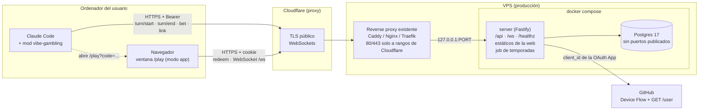
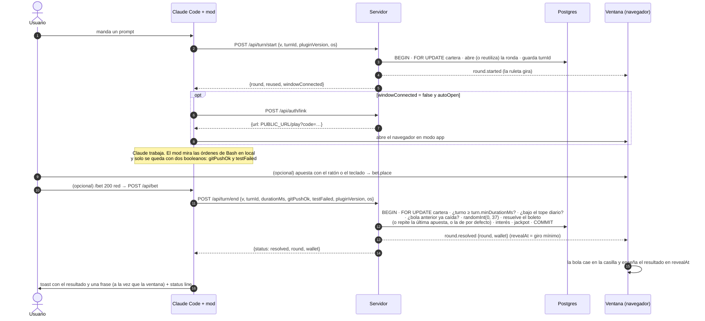
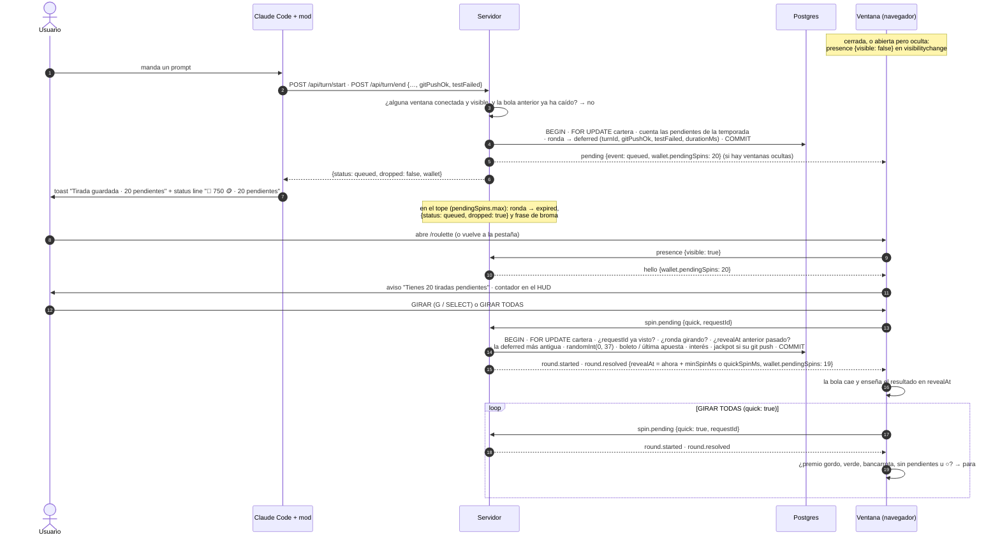
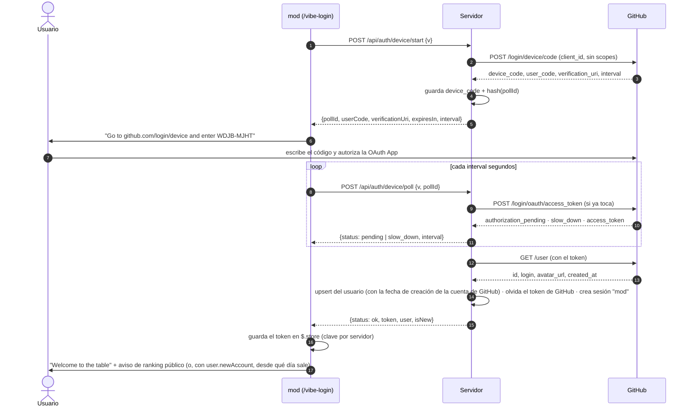
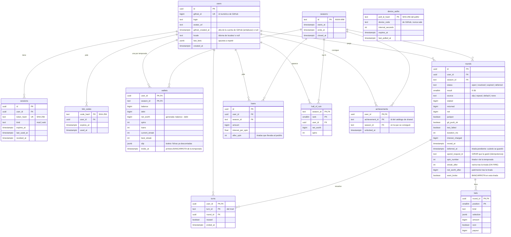

# Arquitectura

vibe-gambling son tres programas que hablan un mismo contrato:

- el **mod**, un plugin de Claude Code que convierte cada turno en una tirada;
- el **servidor**, la única autoridad (tira la ruleta, lleva el dinero de mentira, los rankings y las temporadas) y que además sirve la web;
- la **ventana**, una página web con Three.js que pinta la ruleta en estilo PS1 y recibe lo que pasa por WebSocket.

El contrato (esquemas zod de cada mensaje y la lógica pura de la ruleta) vive en `packages/shared` y está documentado en [PROTOCOLO.md](PROTOCOLO.md). Las decisiones de detalle y su porqué están en [DECISIONES.md](DECISIONES.md).

## Monorepo

| Carpeta                                 | Qué es                                                                                                                                                                                                                                                                                                                        |
| --------------------------------------- | ----------------------------------------------------------------------------------------------------------------------------------------------------------------------------------------------------------------------------------------------------------------------------------------------------------------------------- |
| [`packages/shared`](../packages/shared) | Contrato: esquemas zod del protocolo HTTP y WS (`protocol/`), rutas (`API_ROUTES`), lógica pura de la ruleta (`roulette/`: casillas, apuestas, pagos, parser de `/bet`), economía, rachas y temporadas (`game/`) e i18n (`i18n/`: lógica de las frases, esquemas de `locales/` y la lista de idiomas generada). Sin E/S.      |
| [`packages/server`](../packages/server) | Fastify 5 + `@fastify/websocket` + Drizzle/Postgres 17. API, WebSocket, Device Flow de GitHub, job de temporadas, estáticos de la web, GitHub falso para desarrollo.                                                                                                                                                          |
| [`packages/web`](../packages/web)       | Vite + Three.js. Tres páginas: `/` (landing + ranking), `/play` (la ventana del juego) y `/privacy`. Pipeline PSX propio (320×240, _vertex snapping_, texturas afines, 15 bits con _dithering_, CRT).                                                                                                                         |
| [`packages/mod`](../packages/mod)       | Plugin de Claude Code (API de módulos de hooks). Hooks de turno, comandos, status line, toasts y apertura de la ventana. Sin dependencias: corre en el entorno del engine, no en Node.                                                                                                                                        |
| [`locales/`](../locales)                | Un idioma por carpeta (`en`, `es`, `fr`, `de`): textos del juego, la landing, `/privacy` y el mod, frases de ludópata, metadatos y bandera en pixel art. La web los descubre con `import.meta.glob`; `scripts/gen-locales.ts` genera la lista para el protocolo y la copia del mod ([cómo añadir uno](../locales/README.md)). |
| [`config/`](../config)                  | `game.json` (números del juego), `site.json` (textos de marca y enlaces), `web.json` (ajustes del cliente web). Validados con zod al arrancar.                                                                                                                                                                                |
| [`deploy/`](../deploy)                  | `Dockerfile` (en la raíz), compose de producción, de desarrollo y con Caddy propio, `.env.example`, backups y firewall.                                                                                                                                                                                                       |
| [`scripts/`](../scripts)                | Comprobación SPDX, copia de `shared` para el mod, tipos del engine y generador de [PROTOCOLO.md](PROTOCOLO.md).                                                                                                                                                                                                               |
| [`.claude-plugin/`](../.claude-plugin)  | `marketplace.json`: convierte el repo en un marketplace de Claude Code que apunta a `packages/mod`.                                                                                                                                                                                                                           |

## Componentes



- **Un solo dominio** (`PUBLIC_URL`): el servidor sirve también la build de la web (`WEB_DIST_DIR`), `/config.json` (configuración pública de la web en tiempo de ejecución), la API, el WebSocket y `/healthz`. No hace falta CORS y la CSP es `'self'`.
- **El servidor es la única autoridad.** El navegador nunca decide un resultado ni un saldo: manda intenciones (`bet.place`, `loan.request`) y pinta lo que le dicen. El número sale de `crypto.randomInt(0, 37)` en el servidor.
- **Una sola instancia del servidor.** Las ventanas conectadas viven en memoria (el _hub_). Los cerrojos de dinero están en la base de datos, así que funcionarían con varias, pero difundir los avisos entre instancias exigiría un bus (`LISTEN/NOTIFY`).
- **Detrás de Cloudflare**, la IP real llega en `CF-Connecting-IP` y solo se cree si la conexión viene de `TRUST_PROXY_CIDRS` (la subred de Docker, a la que solo llega el proxy del host, al que solo llega Cloudflare gracias al firewall). Detalles en [DESPLIEGUE.md](DESPLIEGUE.md).

## Un turno

Cada prompt es una tirada. El mod nunca ralentiza ni rompe un turno: toda la red va en segundo plano con un timeout de como mucho 1,5 s (`turnTimeoutMs`), y si el servidor no responde el usuario solo ve `🎰 offline` en la status line.



- **Idempotencia**: `turnId` lo genera el mod; los reintentos no duplican tiradas (tabla en [PROTOCOLO.md](PROTOCOLO.md#idempotencia-de-los-turnos)).
- **Una ronda activa por usuario**: dos sesiones de Claude Code a la vez comparten ronda; la primera que termina la resuelve.
- **Rondas abandonadas** (más de `round.staleAfterMs`, 30 min) caducan sin tirada al detectarlas.
- **Jackpot dev**: con `gitPushOk`, la ganancia se multiplica por `jackpot.gitPushMultiplier`.
- **`claude -p`**: el mod espera a `turn/end` como mucho `turnTimeoutMs` antes de que el proceso termine y no abre ventanas.
- **Sin nadie mirando**: el diagrama de arriba es el turno con una ventana conectada **y visible**. Si no hay ninguna (o todas están ocultas), la tirada se guarda como pendiente: ver abajo.
- **Antiabuso** (detalle en [PROTOCOLO.md](PROTOCOLO.md#antiabuso-ritmo-duración-mínima-y-tope-diario)), todo con la cartera bloqueada y los números de `config/game.json`:
  - **Una tirada por bola**: con la bola de la tirada anterior aún cayendo (`revealAt` en el futuro), el `turn/end` no tira en directo; se guarda como pendiente.
  - **Duración mínima**: el servidor mide el turno entre su `turn/start` y su `turn/end`; por debajo de `turn.minDurationMs` (o sin `turn/start`) no hay tirada (`no_round`) y queda una línea `turn_too_short` en el log, sin datos personales.
  - **Tope diario**: con `dailySpinLimit` tiradas jugadas hoy (día de la zona de la temporada), ni turnos ni GIRAR tiran: `daily_limit` con la hora a la que reabre la mesa.

## Una tirada pendiente

Modelo híbrido: si al terminar el turno no hay ninguna ventana visible, la ronda no se tira; se guarda (ronda `deferred`, con el `git push` y los tests de su turno) y se gasta después desde la ventana con **GIRAR** o **GIRAR TODAS**. El servidor sigue siendo la única autoridad: el número sale del RNG criptográfico **al gastarla**, con las reglas de siempre, y el ritmo lo marca la animación (`revealAt`). Detalle del protocolo en [PROTOCOLO.md](PROTOCOLO.md#tiradas-pendientes).



- **Contador**: `wallet.pendingSpins`, contado en la misma transacción que bloquea la cartera. Sale en `hello`, `/api/me`, `turn/end`, la status line del mod, `/balance` y el HUD.
- **Ranking**: la tirada cuenta (en `spins`, en el patrimonio y en el ranking) cuando se gasta, no cuando se guarda.
- **Caducidad**: al cerrar la temporada, sus pendientes caducan antes de guardar el Salón de la Ruina.

## Login: Device Flow mediado por el servidor

El mod nunca habla con GitHub ni ve nada de GitHub: solo un `pollId` opaco.



- La OAuth App solo necesita _Enable Device Flow_ y su `client_id` (`GITHUB_CLIENT_ID`): el Device Flow no usa _client secret_.
- Las URLs de GitHub son configurables (`GITHUB_OAUTH_BASE_URL`, `GITHUB_API_BASE_URL`, `GITHUB_WEB_BASE_URL`). En desarrollo, en los tests y en el E2E apuntan a un **GitHub falso** (`packages/server/src/fake-github`) que autoriza solo a partir del segundo poll.

## La ventana: enlace de un solo uso

```mermaid
sequenceDiagram
  autonumber
  participant CC as mod
  participant S as Servidor
  participant W as Navegador

  CC->>S: POST /api/auth/link (Bearer)
  S->>S: código de 256 bits · guarda SHA-256 · caduca en LINK_CODE_TTL_SECONDS
  S-->>CC: {url: PUBLIC_URL/play?code=…, expiresIn}
  CC->>W: abre la URL (Chromium --app=… o el navegador por defecto)
  W->>W: history.replaceState: quita ?code de la barra
  W->>S: POST /api/auth/redeem {v, code}
  S->>S: UPDATE … SET used_at WHERE used_at IS NULL AND expires_at > now()
  S-->>W: Set-Cookie: sesión web (HttpOnly; Secure; SameSite=Strict)
  W->>S: GET /ws (Upgrade, cookie, Origin)
  S->>S: comprueba cupo por IP, Origin == PUBLIC_URL y sesión web
  S-->>W: hello (estado completo)
```

El mod solo abre URLs http(s) del mismo origen que su `serverUrl` y sin metacaracteres, así que un servidor autoalojado no puede hacerle abrir otra cosa. El servidor no registra URLs en los logs (solo el patrón de la ruta), así que el código no queda escrito en ningún sitio.

## Modelo de datos

Definido en [`packages/server/src/db/schema.ts`](../packages/server/src/db/schema.ts); las migraciones versionadas (`packages/server/drizzle/`) las genera drizzle-kit y se aplican al arrancar bajo un cerrojo consultivo (`MIGRATE_ON_START`) o con `node dist/migrate.js`.



Reglas que garantiza la base de datos además del código:

- **Dinero**: monedas en `bigint` (siempre dentro de `Number.MAX_SAFE_INTEGER` por el tope de deuda); `balance ≥ 0` y `debt ≥ 0` con `CHECK`.
- **Cerrojos**: toda operación de dinero o de rondas empieza con `FOR KEY SHARE` sobre la temporada y `FOR UPDATE` sobre la cartera del usuario (orden fijo temporada → cartera → turno → ronda, sin interbloqueos). Probado con 150 apuestas simultáneas.
- **Una ronda abierta por usuario**: índice único parcial `WHERE status = 'open'`.
- **Logros**: clave primaria `(user_id, achievement_id)` + `INSERT … ON CONFLICT DO NOTHING RETURNING`: cada logro se guarda y se anuncia una sola vez aunque dos transacciones lo intenten a la vez.
- **Tiradas pendientes**: rondas `deferred` (con `deferred_at` y el turno que las guardó, por `CHECK`), en cola por el índice parcial `(user_id, season_id, deferred_at) WHERE status = 'deferred'`; `(user_id, spend_request_id)` único para que un GIRAR repetido no tire dos veces.
- **Borrado de cuenta**: todo lo que cuelga de `users` es `ON DELETE CASCADE`.
- **Cuentas de GitHub nuevas fuera del ranking**: `users.github_created_at` (el `created_at` del perfil público de GitHub, reescrito en cada login) decide quién sale en los rankings, en el puesto propio de `/api/me` y en el Salón de la Ruina: solo las cuentas con al menos `leaderboard.minAccountAgeDays` días (de 24 h, contra el reloj inyectado) o sin el dato (las de antes de la regla, hasta su próximo login). Se borra con la cuenta.
- **Tokens**: solo hashes SHA-256 (`sessions`, `link_codes`, `device_auths`). El token de GitHub no se guarda nunca.

## Temporadas

Una temporada es un mes natural que empieza el día `season.startDay` a las 00:00 en `season.timeZone` (`config/game.json`: el 1, Europe/Madrid). Su id es `AAAA-MM`.

Cada `SEASON_CHECK_INTERVAL_MS`, un job del servidor:

1. toma `pg_try_advisory_xact_lock` (si hubiera dos instancias, solo una trabaja);
2. cierra las temporadas vencidas: caduca sus rondas abiertas y sus tiradas pendientes, devuelve al saldo las fichas de los boletos, guarda el top `hallOfRuinSize` de arruinados no ocultos y con cuenta de GitHub de al menos `leaderboard.minAccountAgeDays` días en `hall_of_ruin` y marca `closed_at`;
3. crea la fila de la temporada nueva y avisa a las ventanas con `season.changed`;
4. purga códigos de enlace usados o caducados, logins de GitHub a medias y sesiones caducadas o revocadas.

Las carteras de la temporada nueva se crean de forma perezosa con la primera operación de dinero; hasta entonces `/api/me` y `hello` enseñan una cartera "virtual" con el saldo inicial.

## El mod por dentro

- `hooks/register.ts` es el único archivo que toca `$` (el engine lo exige); lo adapta a una interfaz `Io` pequeña (`hooks/lib/io.ts`) y todo `hooks/lib` es TypeScript puro que se prueba sin engine.
- `turn.start` (solo el bucle principal) → `turn/start`; `tool.call` de Bash → mira la orden y su salida **en local** para calcular `gitPushOk` y `testFailed` y las olvida; `turn.complete` sin `agentId` → `turn/end` y el toast.
- No puede importar `shared` ni zod (se instala solo `packages/mod`): `pnpm sync:mod` copia las frases y las constantes del protocolo a `hooks/generated/` (y genera `manifest.ts` con la versión y los valores por defecto de `plugin.json`, para no leer el manifiesto del disco), y `packages/shared/test/mod-contract.test.ts` falla si la copia está desactualizada y valida los cuerpos del mod con los esquemas estrictos.
- Configuración en el `userConfig` del manifiesto (`serverUrl`, `autoOpen`, idioma, timeouts…), con sus rangos; el token de sesión en `$.store`, con una clave por servidor.
- La ventana se abre con un Chromium en modo app (`--app=<url> --window-size=…`) si encuentra uno, o con el navegador por defecto (`xdg-open`, `open`, `start`).

## La ventana por dentro

- Toda la interfaz del juego se pinta **dentro** del framebuffer de 320×240 (no hay DOM encima), así que el HUD tiembla, se ditheriza y se curva con el CRT igual que la escena. Accesibilidad: región `aria-live` con el estado y los resultados, y todo manejable con teclado o mando.
- La bola es determinista: la animación termina exactamente en el número que dijo el servidor, y el resultado no se enseña antes de `revealAt`.
- Reconexión con backoff exponencial y `sync` al volver; ping de aplicación (`config/web.json`).
- `/play?demo`: un servidor simulado en el navegador (lógica de `shared` y azar local) para probar la ventana sin cuenta. No toca el servidor.
- CSP estricta: sin scripts ni estilos inline; fuentes, texturas (procedurales) y sonidos (sintetizados con WebAudio) salen del propio dominio o del código.

## Configuración

Nada configurable está escrito en el código:

| Dónde                                                     | Qué                                                                                                           | Lo valida                                  |
| --------------------------------------------------------- | ------------------------------------------------------------------------------------------------------------- | ------------------------------------------ |
| Variables de entorno (`deploy/.env.example`)              | URLs, puertos, base de datos, GitHub, sesiones, rate limits, WebSocket, cachés, proxy                         | `packages/server/src/config.ts` (zod)      |
| `config/game.json`                                        | Saldo inicial, fichas, préstamo y TAE, jackpot, temporada, giro mínimo, rachas, edad mínima para el ranking   | `gameConfigSchema` (shared)                |
| `config/site.json`                                        | Autor, repo, comando de instalación, enlaces de ayuda, otros proyectos, datos de la instancia para `/privacy` | `siteConfigSchema` (server)                |
| `config/web.json`                                         | Ping y reconexión del WebSocket, tiempos de la interfaz, ranking, demo                                        | `webClientConfigSchema` (web, en la build) |
| `userConfig` de `packages/mod/.claude-plugin/plugin.json` | URL del servidor, apertura automática, idioma, timeouts del mod                                               | el engine (rangos `min`/`max`) y el mod    |

Si falta algo o no cuadra, el proceso no arranca y dice qué. Las únicas constantes del código son las reglas de la ruleta europea (casillas, colores, orden del cilindro, pagos).
