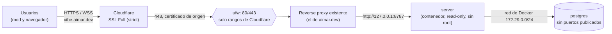

# Despliegue en producción

Guía paso a paso para poner vibe-gambling en **https://vibe.aimar.dev**: una VPS de IONOS que ya sirve `aimar.dev` con su propio reverse proxy, detrás del proxy de Cloudflare.

> [!IMPORTANT]
> **No se ha desplegado nada.** Todo se ha probado en local (Docker Compose, Postgres local, el mod con `--plugin-dir`). Esta guía lo deja listo para que Aimar lo haga cuando quiera. Ninguno de los scripts de `deploy/` se ha ejecutado contra una máquina real.

Una vez hecha la preparación (secciones 1 a 8, una sola vez), desplegar es:

1. **copiar el `.env`** (`deploy/.env.example` → `/srv/vibe-gambling/.env`, con dos valores cambiados);
2. **un comando**: `docker compose pull && docker compose up -d`;
3. **añadir el sitio al reverse proxy** que ya hay (un bloque de Caddy, Nginx o Traefik).

¿Tu propia instancia en una máquina vacía, sin Cloudflare? Mira [SELF-HOSTING.md](SELF-HOSTING.md).

## Índice

0. [Cómo queda](#0-cómo-queda)
1. [DNS (ya hecho): cómo comprobarlo](#1-dns-ya-hecho-cómo-comprobarlo)
2. [Cloudflare: SSL, certificado de origen y ajustes](#2-cloudflare-ssl-certificado-de-origen-y-ajustes)
3. [Docker y Compose en la VPS](#3-docker-y-compose-en-la-vps)
4. [Usuario y carpeta de despliegue](#4-usuario-y-carpeta-de-despliegue)
5. [Firewall: 80/443 solo para Cloudflare (obligatorio)](#5-firewall-80443-solo-para-cloudflare-obligatorio)
6. [La OAuth App de GitHub](#6-la-oauth-app-de-github)
7. [El `.env` de producción](#7-el-env-de-producción)
8. [La imagen Docker](#8-la-imagen-docker)
9. [Arrancar](#9-arrancar)
10. [Añadir el sitio al reverse proxy](#10-añadir-el-sitio-al-reverse-proxy)
11. [Comprobación final](#11-comprobación-final)
12. [Copias de seguridad](#12-copias-de-seguridad)
13. [Actualizaciones](#13-actualizaciones)
14. [Monitorización](#14-monitorización)
15. [Problemas frecuentes](#15-problemas-frecuentes)

## 0. Cómo queda



| Pieza                    | Dónde                                                                                                                       |
| ------------------------ | --------------------------------------------------------------------------------------------------------------------------- |
| Compose de producción    | [`deploy/docker-compose.yml`](../deploy/docker-compose.yml): `server` + `postgres:17-alpine`, sin proxy                     |
| Variables de entorno     | [`deploy/.env.example`](../deploy/.env.example) (todas documentadas; el servidor las valida al arrancar)                    |
| Imagen                   | `ghcr.io/aimarmndz/vibe-gambling:<tag>` (la publica [`docker.yml`](../.github/workflows/docker.yml) con cada etiqueta `v*`) |
| Copias de seguridad      | [`deploy/backup.sh`](../deploy/backup.sh)                                                                                   |
| Firewall                 | [`deploy/cloudflare-firewall.sh`](../deploy/cloudflare-firewall.sh)                                                         |
| Despliegues desde GitHub | [`deploy.yml`](../.github/workflows/deploy.yml) (solo a mano: _Run workflow_)                                               |

El servidor escucha **solo en `127.0.0.1:${PORT}`** de la VPS (8787 por defecto): nada de esto es accesible desde fuera salvo a través del reverse proxy. Las migraciones de la base de datos se aplican solas al arrancar (`MIGRATE_ON_START=true`). La imagen corre como usuario sin privilegios, con el sistema de archivos de solo lectura y `cap_drop: ALL`.

## 1. DNS (ya hecho): cómo comprobarlo

`vibe.aimar.dev` ya existe y está **detrás del proxy de Cloudflare** (nube naranja), igual que `aimar.dev`. Para comprobarlo:

1. En el panel de Cloudflare → zona `aimar.dev` → **DNS → Records**: hay un registro `vibe` (tipo `A`/`AAAA` con la IP de la VPS, o un `CNAME` a `vps.aimar.dev`) con **Proxy status: Proxied** (nube naranja). `vps.aimar.dev` está en **DNS only** (nube gris): es el que publica la IP real y se usa para SSH.
2. Desde cualquier ordenador:

   ```sh
   dig +short vibe.aimar.dev   # IPs de Cloudflare (104.x, 172.64–71.x…), NO la de la VPS
   dig +short vps.aimar.dev    # la IP real de la VPS
   curl -sI https://vibe.aimar.dev | grep -iE '^(server|cf-ray)'
   # server: cloudflare
   # cf-ray: …
   ```

   Hasta que el servidor esté arrancado y en el proxy, Cloudflare contestará con un error 52x (521/522/525/526): es lo esperado.

## 2. Cloudflare: SSL, certificado de origen y ajustes

### Modo SSL: Full (strict)

En **SSL/TLS → Overview**, el modo tiene que ser **Full (strict)**: Cloudflare cifra hasta la VPS y comprueba el certificado de origen. Ese ajuste es de **toda la zona**: si `aimar.dev` funciona hoy con otro modo y no quieres tocarlo, aplícalo solo a este nombre con una **Configuration Rule** (_Rules → Configuration Rules_: «Hostname equals `vibe.aimar.dev`» → _SSL_: _Full (strict)_).

### Certificado de origen de Cloudflare (opción por defecto)

Un _Origin Certificate_ es un certificado gratuito, de hasta 15 años, que **solo** reconoce Cloudflare. Es justo lo que hace falta, porque al origen solo llega Cloudflare (sección 5).

1. **SSL/TLS → Origin Server → Create Certificate**.
2. _Generate private key and CSR with Cloudflare_, tipo de clave RSA (2048) o ECC.
3. Nombres: `aimar.dev` y `*.aimar.dev` (el comodín cubre `vibe.aimar.dev`). **Si `aimar.dev` ya usa un certificado de origen con `*.aimar.dev`, reutilízalo** y sáltate este paso.
4. Copia el certificado y la clave privada (la clave solo se enseña una vez) a la VPS:

   ```sh
   sudo install -d -m 755 /etc/ssl/cloudflare
   sudo nano /etc/ssl/cloudflare/aimar.dev.pem   # pega el certificado
   sudo nano /etc/ssl/cloudflare/aimar.dev.key   # pega la clave privada
   sudo chmod 644 /etc/ssl/cloudflare/aimar.dev.pem
   sudo chmod 600 /etc/ssl/cloudflare/aimar.dev.key
   # Si el proxy no corre como root, dale la clave a su grupo (p. ej. caddy o www-data):
   # sudo chgrp caddy /etc/ssl/cloudflare/aimar.dev.key && sudo chmod 640 /etc/ssl/cloudflare/aimar.dev.key
   ```

Opcional, más defensa: **Authenticated Origin Pulls** (_SSL/TLS → Origin Server_) hace que Cloudflare presente un certificado de cliente y el proxy rechace a cualquier otro. Con el firewall de la sección 5 no es imprescindible.

Alternativa sin certificado de origen (un certificado de Let's Encrypt con reto **DNS-01**): ver [10.5](#105-alternativa-lets-encrypt-con-dns-01).

### Ajustes de Cloudflare que importan

| Ajuste                                             | Valor                                | Por qué                                                                                                                                                      |
| -------------------------------------------------- | ------------------------------------ | ------------------------------------------------------------------------------------------------------------------------------------------------------------ |
| **Network → WebSockets**                           | **On** (suele estarlo)               | La ventana usa `wss://vibe.aimar.dev/ws`. Cloudflare corta un WebSocket tras 100 s sin tráfico; el servidor manda un ping cada `WS_PING_INTERVAL_MS` (30 s). |
| **SSL/TLS → Edge Certificates → Always Use HTTPS** | On (sin problema)                    | Con certificado de origen no molesta. **Rompe el reto HTTP-01** de Let's Encrypt (ver 10.5): no uses HTTP-01 detrás de Cloudflare.                           |
| **Speed → Optimization → Rocket Loader**           | **Off** para este nombre             | Reescribe los `<script>` e inyecta JavaScript inline: la CSP estricta lo bloquea y la página no arranca.                                                     |
| **Scrape Shield → Email Address Obfuscation**      | Off para este nombre                 | Inyecta un script inline (bloqueado por la CSP).                                                                                                             |
| **Web Analytics / Zaraz** (inyección automática)   | **Off** para este nombre             | La política de privacidad promete **cero analíticas de terceros**.                                                                                           |
| **Security → Bots (Bot Fight Mode)** y desafíos    | Sin desafíos en `/api/*` ni `/ws`    | El mod es un cliente HTTP sin navegador: un _challenge_ de Cloudflare rompe los turnos. Si lo activas, excluye esas rutas con una regla.                     |
| **Caching**                                        | Por defecto (sin "Cache Everything") | El servidor ya manda `Cache-Control` correcto: `no-store` en `/api`, `no-cache` en el HTML, `immutable` en `/assets`.                                        |

Los ajustes que no se pueden apagar por nombre (Rocket Loader, ofuscación…) se desactivan para `vibe.aimar.dev` con una **Configuration Rule** igual que la del SSL.

## 3. Docker y Compose en la VPS

Si la VPS aún no tiene Docker, instala Docker Engine y el plugin de Compose desde el repositorio oficial ([docs.docker.com/engine/install](https://docs.docker.com/engine/install/), sección de tu distribución). Comprueba:

```sh
docker --version
docker compose version   # Compose v2 (el plugin), no el antiguo docker-compose
```

## 4. Usuario y carpeta de despliegue

Un usuario sin contraseña, solo con clave SSH, que puede usar Docker (el grupo `docker` equivale a root en la práctica: no le des esa clave a nada más que al workflow de despliegue).

```sh
sudo adduser --disabled-password --gecos "" deploy
sudo usermod -aG docker deploy
sudo install -d -o deploy -g deploy -m 750 /srv/vibe-gambling
```

Clave SSH **solo para desplegar** (en tu ordenador; la privada irá al secret `DEPLOY_SSH_KEY` de GitHub, sección 13):

```sh
ssh-keygen -t ed25519 -f ~/.ssh/vibe-deploy -C "vibe-gambling deploy" -N ""
ssh-copy-id -i ~/.ssh/vibe-deploy.pub deploy@vps.aimar.dev
```

Copia los archivos de `deploy/` que hacen falta en la VPS (desde un clon del repo):

```sh
scp deploy/docker-compose.yml deploy/.env.example deploy/backup.sh deploy@vps.aimar.dev:/srv/vibe-gambling/
scp deploy/cloudflare-firewall.sh you@vps.aimar.dev:/tmp/
ssh deploy@vps.aimar.dev 'chmod 750 /srv/vibe-gambling/backup.sh'
```

`cloudflare-firewall.sh` lo ejecuta **root**: instálalo fuera de la carpeta del usuario `deploy` (si no, quien controle `deploy` podría cambiar lo que root ejecuta):

```sh
sudo install -o root -g root -m 755 /tmp/cloudflare-firewall.sh /usr/local/sbin/vibe-cloudflare-firewall
```

## 5. Firewall: 80/443 solo para Cloudflare (obligatorio)

**No es opcional.** `vps.aimar.dev` está en "DNS only" y publica la IP real de la VPS. Sin este firewall cualquiera podría saltarse Cloudflare, hablar directamente con el reverse proxy y mandar una cabecera `CF-Connecting-IP` inventada (el servidor confía en ella porque le llega desde el proxy del host), lo que anula el rate limit por IP.

> [!WARNING]
> Antes de aplicarlo, comprueba que **todos** los sitios que sirve la VPS van por Cloudflare (nube naranja). Uno que no, se quedaría fuera.

Con `ufw` (el script lo usa):

```sh
# 1. SSH primero, restringido a tus IPs si son fijas (si no, al menos con límite de intentos)
sudo ufw allow from <TU_IP> to any port 22 proto tcp
# sudo ufw limit 22/tcp          # alternativa si tu IP cambia
sudo ufw default deny incoming
sudo ufw default allow outgoing
sudo ufw enable

# 2. 80/443 solo para los rangos publicados en https://www.cloudflare.com/ips/
sudo vibe-cloudflare-firewall --dry-run   # enseña lo que haría
sudo vibe-cloudflare-firewall             # lo aplica (idempotente)
sudo ufw status numbered
```

El script descarga los rangos IPv4 e IPv6 de Cloudflare, borra cualquier `allow 80`/`allow 443` abierto y sus propias reglas anteriores, y abre 80/443 solo a esos rangos. Si la descarga falla o llega incompleta, **no toca nada**. No cierra el 22: eso es cosa tuya (arriba).

Cloudflare cambia sus rangos de vez en cuando: un cron semanal de root los mantiene al día.

```sh
sudo crontab -e
# 0 5 * * 1 /usr/local/sbin/vibe-cloudflare-firewall >> /var/log/vibe-cloudflare-firewall.log 2>&1
```

Comprobación desde fuera (desde tu ordenador, que no es Cloudflare): `curl -m 5 -kI https://$(dig +short vps.aimar.dev)` tiene que **agotar el tiempo**, mientras `https://vibe.aimar.dev` y `https://aimar.dev` siguen funcionando.

> [!CAUTION]
> **Si el reverse proxy existente corre dentro de Docker** y publica 80/443 con `ports:`, las reglas de `ufw` **no le afectan**: Docker inserta sus propias reglas de iptables antes que las de ufw. En ese caso el filtro hay que ponerlo en la cadena `DOCKER-USER` (permitir los rangos de Cloudflare hacia 80/443 y descartar el resto), o usar además el **firewall del Cloud Panel de IONOS** (_Red → Políticas de firewall_), que filtra antes de llegar a la VPS (pero no se actualiza solo con los rangos de Cloudflare). El servidor de vibe-gambling no tiene este problema: solo se publica en `127.0.0.1`.

## 6. La OAuth App de GitHub

El login es el Device Flow de GitHub mediado por el servidor. Solo hace falta el **Client ID** (el Device Flow no usa _client secret_).

1. GitHub (cuenta de Aimar) → **Settings → Developer settings → OAuth Apps → New OAuth App**.
2. Rellena:

   | Campo                      | Valor                                                                                       |
   | -------------------------- | ------------------------------------------------------------------------------------------- |
   | Application name           | `vibe-gambling` (lo verán los usuarios al autorizar; sin "Claude", "PlayStation" ni "Sony") |
   | Homepage URL               | `https://vibe.aimar.dev`                                                                    |
   | Application description    | `Every prompt is a spin. Fake coins only.` (opcional)                                       |
   | Authorization callback URL | `https://vibe.aimar.dev/` (el formulario lo exige; el Device Flow no lo usa)                |

3. **Register application**. En la página de la app, marca **Enable Device Flow** y guarda (**Update application**). Sin esto, el login falla con `502 github_unavailable` (GitHub responde `device_flow_disabled`).
4. Copia el **Client ID** (empieza por `Ov23li…`) para `GITHUB_CLIENT_ID`. **No generes un client secret**: no hace falta.

El servidor pide el login **sin scopes**: solo puede leer el perfil público (id, login, avatar). El token de GitHub se descarta nada más leer el perfil.

## 7. El `.env` de producción

```sh
ssh deploy@vps.aimar.dev
cd /srv/vibe-gambling
cp .env.example .env
chmod 600 .env
nano .env
```

Todas las variables están explicadas en el propio archivo. Para `vibe.aimar.dev` solo hay que tocar:

| Variable            | Valor                                                                                    |
| ------------------- | ---------------------------------------------------------------------------------------- |
| `POSTGRES_PASSWORD` | `openssl rand -hex 32` (tiene que ser segura en una URL: hexadecimal va bien)            |
| `GITHUB_CLIENT_ID`  | El Client ID de la sección 6                                                             |
| `IMAGE_TAG`         | La versión a desplegar, p. ej. `0.1.0` (mejor que `latest`: así sabes qué hay en marcha) |

Y comprobar que estos valores no chocan con lo que ya hay en la VPS:

| Variable                         | Comprobación                                                                                                                                                                            |
| -------------------------------- | --------------------------------------------------------------------------------------------------------------------------------------------------------------------------------------- |
| `PORT` (8787)                    | `ss -ltnp \| grep ':8787 '` no devuelve nada.                                                                                                                                           |
| `DOCKER_SUBNET` (172.29.0.0/24)  | No la usa otra red de Docker: `docker network inspect $(docker network ls -q) --format '{{.Name}} {{range .IPAM.Config}}{{.Subnet}}{{end}}'`.                                           |
| `TRUST_PROXY_CIDRS`              | **Igual que `DOCKER_SUBNET`.** El proxy del host llega al contenedor a través del puerto publicado, así que el servidor lo ve con una IP de esa subred. Si cambias una, cambia la otra. |
| `REAL_IP_HEADER`                 | `CF-Connecting-IP` (la pone Cloudflare).                                                                                                                                                |
| `BACKUP_DIR`, `BACKUP_KEEP_DAYS` | Carpeta de las copias (sección 12) y días que se guardan.                                                                                                                               |

Lo demás (`PUBLIC_URL=https://vibe.aimar.dev`, `IS_OFFICIAL=true`, `SESSION_COOKIE_NAME=__Host-vibe_session`, rate limits, WebSocket, cachés…) ya viene con los valores de producción. `EXTRA_ALLOWED_ORIGINS` se queda **vacío**. `SITE_ADDRESS` solo se usa con el Caddy propio de [SELF-HOSTING.md](SELF-HOSTING.md): aquí se ignora.

Si falta una variable o tiene un valor raro, el servidor **no arranca** y el log dice cuál (`docker compose logs server`).

## 8. La imagen Docker

La imagen la publica el workflow [`docker.yml`](../.github/workflows/docker.yml) en `ghcr.io/aimarmndz/vibe-gambling` al empujar una etiqueta `vX.Y.Z` (amd64 + arm64, con SBOM y procedencia). Lleva el servidor, la build de la web, las migraciones y `config/*.json`.

- Para el primer despliegue tiene que existir la etiqueta: `git tag -a v0.1.0 -m "v0.1.0" && git push origin v0.1.0` (lo hace Aimar en el lanzamiento, ver [launch/CHECKLIST.md](launch/CHECKLIST.md)).
- El paquete de GHCR tiene que ser **público** (GitHub → tu perfil → _Packages_ → `vibe-gambling` → _Package settings_ → _Change visibility_). Si se queda privado, la VPS necesita iniciar sesión con un token (PAT clásico con `read:packages`):

  ```sh
  echo "<PAT>" | docker login ghcr.io -u Aimarmndz --password-stdin   # como usuario deploy
  ```

- `config/game.json` y `config/site.json` van **dentro de la imagen**: cambiarlos es publicar una versión nueva (o montar tus propios archivos encima con un `docker-compose.override.yml`).

## 9. Arrancar

```sh
cd /srv/vibe-gambling
docker compose pull
docker compose up -d
docker compose ps                         # server: running (healthy); postgres: healthy
curl -fsS http://127.0.0.1:8787/healthz   # {"ok":true}
docker compose logs --tail 50 server      # migraciones aplicadas y servidor escuchando
```

La primera vez Postgres crea la base de datos con `POSTGRES_USER/PASSWORD/DB` y el servidor aplica las migraciones. Hasta que el reverse proxy apunte aquí, desde fuera sigue saliendo el 52x de Cloudflare.

## 10. Añadir el sitio al reverse proxy

`vibe.aimar.dev` es **un sitio más** del proxy que ya sirve `aimar.dev`. Lo que necesita:

- TLS con el certificado de origen de Cloudflare (o DNS-01, 10.5);
- todo el tráfico a `http://127.0.0.1:8787` (o el `PORT` que pusieras), **WebSockets incluidos** (`/ws`);
- pasar las cabeceras tal cual (en especial `CF-Connecting-IP`, que es la que lee el servidor, y `Origin`, que comprueba el WebSocket);
- **no guardar la query de `/play?code=…` en el log de acceso**: es un código de un solo uso de 60 s, pero el servidor se cuida de no registrarlo y el proxy no debería deshacerlo. Mejor aún, sin IPs: la [política de privacidad](PRIVACIDAD.md) dice que no se guardan.

No hace falta tocar cabeceras de seguridad (CSP, HSTS, etc.): las pone el servidor.

### 10.1 Caddy

```caddyfile
vibe.aimar.dev {
	# Certificado de origen de Cloudflare (con esto Caddy no intenta pedir uno a Let's Encrypt)
	tls /etc/ssl/cloudflare/aimar.dev.pem /etc/ssl/cloudflare/aimar.dev.key
	encode zstd gzip
	# reverse_proxy pasa los WebSockets y las cabeceras del cliente (CF-Connecting-IP incluida)
	reverse_proxy 127.0.0.1:8787
	# Sin directiva `log`: Caddy no escribe log de acceso para este sitio
}
```

`sudo caddy validate --config /etc/caddy/Caddyfile && sudo systemctl reload caddy`.

### 10.2 Nginx

```nginx
# En el bloque http {} (si ya tienes un map igual para otros sitios, no lo repitas)
map $http_upgrade $connection_upgrade {
    default upgrade;
    ''      close;
}

# Log sin IP y sin query ($uri no lleva los argumentos)
log_format vibe_noquery '$time_iso8601 "$request_method $uri" $status $body_bytes_sent $request_time';

server {
    listen 443 ssl;
    listen [::]:443 ssl;
    http2 on;
    server_name vibe.aimar.dev;

    ssl_certificate     /etc/ssl/cloudflare/aimar.dev.pem;
    ssl_certificate_key /etc/ssl/cloudflare/aimar.dev.key;

    access_log /var/log/nginx/vibe.access.log vibe_noquery;

    location / {
        proxy_pass http://127.0.0.1:8787;
        proxy_http_version 1.1;
        proxy_set_header Host $host;
        # WebSockets (/ws)
        proxy_set_header Upgrade $http_upgrade;
        proxy_set_header Connection $connection_upgrade;
        # IP real que pone Cloudflare (Nginx ya la pasa; así queda explícito)
        proxy_set_header CF-Connecting-IP $http_cf_connecting_ip;
        # Más que el ping del servidor (30 s), para no cortar el WebSocket
        proxy_read_timeout 120s;
        proxy_send_timeout 120s;
    }
}

server {
    listen 80;
    listen [::]:80;
    server_name vibe.aimar.dev;
    return 301 https://$host$request_uri;
}
```

`sudo nginx -t && sudo systemctl reload nginx`.

### 10.3 Traefik

Con Traefik instalado en el host (proveedor de archivos, configuración dinámica):

```yaml
# /etc/traefik/dynamic/vibe.yml
http:
  routers:
    vibe:
      rule: Host(`vibe.aimar.dev`)
      entryPoints: [websecure]
      service: vibe
      tls: {}
  services:
    vibe:
      loadBalancer:
        servers:
          - url: http://127.0.0.1:8787

tls:
  certificates:
    - certFile: /etc/ssl/cloudflare/aimar.dev.pem
      keyFile: /etc/ssl/cloudflare/aimar.dev.key
```

Traefik pasa los WebSockets y las cabeceras sin configuración extra. Su log de acceso está apagado por defecto; si lo tienes activo, guarda la ruta con la query y la IP: desactívalo para este router (en Traefik ≥ 3.1, `observability: { accessLogs: false }` en el router) o filtra esos campos.

### 10.4 Si el proxy corre en un contenedor

Un proxy dentro de Docker (Traefik con etiquetas, Caddy o Nginx en un contenedor) **no puede llegar a `127.0.0.1:8787` del host**. En ese caso, en vez de publicar el puerto, conecta el servidor a la red del proxy con un `docker-compose.override.yml` junto al compose (Compose lo lee solo, también desde `deploy.yml`):

```yaml
# /srv/vibe-gambling/docker-compose.override.yml (ejemplo con Traefik y una red externa "proxy")
services:
  server:
    ports: !reset [] # ya no hace falta publicar nada en el host (Compose ≥ 2.24)
    networks: [vibe, proxy]
    labels:
      - traefik.enable=true
      - traefik.docker.network=proxy
      - traefik.http.routers.vibe.rule=Host(`vibe.aimar.dev`)
      - traefik.http.routers.vibe.entrypoints=websecure
      - traefik.http.routers.vibe.tls=true
      - traefik.http.services.vibe.loadbalancer.server.port=8787

networks:
  proxy:
    external: true
```

Ahora el servidor ve las conexiones con una IP de la red `proxy`, así que **`TRUST_PROXY_CIDRS` tiene que ser la subred de esa red** (`docker network inspect proxy --format '{{range .IPAM.Config}}{{.Subnet}}{{end}}'`), no `DOCKER_SUBNET`. Con Caddy o Nginx en contenedor es lo mismo sin las etiquetas: su `reverse_proxy`/`proxy_pass` apunta a `http://server:8787` (el nombre del servicio en la red compartida).

### 10.5 Alternativa: Let's Encrypt con DNS-01

Si prefieres un certificado público en el origen en vez del de Cloudflare, el único reto que funciona detrás del proxy de Cloudflare es **DNS-01**:

- **HTTP-01 no**: con **Always Use HTTPS** Cloudflare redirige el reto a HTTPS antes de que llegue al origen, y en Full (strict) el origen aún no tiene certificado válido (526).
- **TLS-ALPN-01 no**: Cloudflare termina el TLS, el reto nunca llega al origen.

Con Caddy hace falta una build con el módulo de DNS de Cloudflare (`xcaddy build --with github.com/caddy-dns/cloudflare`) y un **API token** de Cloudflare (_My Profile → API Tokens → Create Token_, plantilla _Edit zone DNS_, limitado a la zona `aimar.dev`), en la variable de entorno `CF_API_TOKEN` del servicio de Caddy:

```caddyfile
vibe.aimar.dev {
	tls {
		dns cloudflare {env.CF_API_TOKEN}
	}
	encode zstd gzip
	reverse_proxy 127.0.0.1:8787
}
```

Con Nginx o Traefik, lo equivalente es certbot con `python3-certbot-dns-cloudflare` o el `dnsChallenge` de Traefik con el proveedor `cloudflare`, con el mismo token.

## 11. Comprobación final

```sh
curl -fsS https://vibe.aimar.dev/healthz              # {"ok":true}
curl -fsS https://vibe.aimar.dev/api/meta             # {"v":1,"protocol":1,"name":"vibe-gambling","isOfficial":true,…}
curl -sI https://vibe.aimar.dev/ | grep -iE 'content-security-policy|strict-transport-security'
```

Y de verdad, desde Claude Code con el plugin instalado: `/vibe-server` (debe decir `https://vibe.aimar.dev — vibe-gambling (official)`), `/vibe-login`, un prompt cualquiera (se abre la ventana, la ruleta gira y la bola cae al terminar) y `/balance`. En la ventana, las herramientas de desarrollador no deben mostrar errores de CSP ni de WebSocket.

## 12. Copias de seguridad

`backup.sh` hace un `pg_dump` en formato _custom_ (comprimido) a través de `docker compose exec`, lo deja en `BACKUP_DIR` con permisos `600` y borra los de más de `BACKUP_KEEP_DAYS` días. Lee la configuración del `.env` de su carpeta.

```sh
# Una vez, como root: la carpeta de las copias y el log, del usuario deploy
sudo install -d -o deploy -g deploy -m 700 /var/backups/vibe-gambling
sudo install -o deploy -g deploy -m 640 /dev/null /var/log/vibe-backup.log

# Como deploy: una copia a mano para probar
cd /srv/vibe-gambling && ./backup.sh
ls -lh /var/backups/vibe-gambling

# Cron diario (crontab -e del usuario deploy)
15 4 * * * cd /srv/vibe-gambling && ./backup.sh >> /var/log/vibe-backup.log 2>&1
```

**Restaurar** (sobrescribe la base de datos: para el servidor, restaura en una sola transacción y lo vuelve a arrancar):

```sh
cd /srv/vibe-gambling
./backup.sh restore /var/backups/vibe-gambling/vibe-20261013T041500Z.dump
```

**Probar una copia sin tocar producción** (hazlo de vez en cuando: una copia que nunca se ha restaurado no es una copia):

```sh
docker run -d --rm --name vibe-restore-test -e POSTGRES_PASSWORD=test postgres:17-alpine
sleep 5 && docker exec vibe-restore-test createdb -U postgres vibe
docker exec -i vibe-restore-test pg_restore -U postgres -d vibe --no-owner < /var/backups/vibe-gambling/vibe-<fecha>.dump
docker exec vibe-restore-test psql -U postgres -d vibe -c 'select count(*) from users'
docker rm -f vibe-restore-test
```

**Fuera de la VPS.** Las copias en la misma VPS no protegen de perderla. Copia `BACKUP_DIR` a otro sitio (restic, rclone o rsync a otro servidor o a un almacenamiento de objetos en la UE), **cifrado**: los volcados contienen logins y avatares de GitHub. Ten en cuenta que una cuenta borrada sigue en las copias hasta `BACKUP_KEEP_DAYS` días (está dicho en [PRIVACIDAD.md](PRIVACIDAD.md)); aplica la misma retención fuera.

## 13. Actualizaciones

### Publicar una versión

1. Sube la versión en los `package.json` y en `packages/mod/.claude-plugin/plugin.json`, con su commit.
2. `git tag -a vX.Y.Z -m "vX.Y.Z" && git push origin vX.Y.Z`.
3. [`docker.yml`](../.github/workflows/docker.yml) construye y publica `ghcr.io/aimarmndz/vibe-gambling:X.Y.Z` (y `X.Y`, y `latest` si es estable).

### Desplegar con `deploy.yml`

[`deploy.yml`](../.github/workflows/deploy.yml) solo se lanza a mano (**Actions → Deploy → Run workflow**): entra por SSH, hace `docker compose pull && docker compose up -d --remove-orphans && docker image prune -f` en la carpeta de la VPS y espera a que `/healthz` conteste (hasta ~3 min). Nunca hay dos despliegues a la vez ni se cancela uno a medias.

Una vez: crea el entorno **`production`** (_Settings → Environments_; opcional: _Required reviewers_ para aprobar cada despliegue) y estos secrets (en el entorno o en el repo, _Settings → Secrets and variables → Actions_):

| Secret               | Valor                                                                                                                                                 |
| -------------------- | ----------------------------------------------------------------------------------------------------------------------------------------------------- |
| `DEPLOY_HOST`        | `vps.aimar.dev` (el nombre "DNS only" con la IP real; **no** `vibe.aimar.dev`, que es Cloudflare y no deja pasar SSH)                                 |
| `DEPLOY_USER`        | `deploy`                                                                                                                                              |
| `DEPLOY_SSH_KEY`     | La clave **privada** `~/.ssh/vibe-deploy` de la sección 4 (entera, con las líneas `BEGIN`/`END`)                                                      |
| `DEPLOY_PATH`        | `/srv/vibe-gambling`                                                                                                                                  |
| `DEPLOY_KNOWN_HOSTS` | Salida de `ssh-keyscan -t ed25519 vps.aimar.dev`, **comprobada** contra la huella real (`ssh-keygen -lf /etc/ssh/ssh_host_ed25519_key.pub` en la VPS) |
| `DEPLOY_HEALTH_URL`  | `https://vibe.aimar.dev/healthz`                                                                                                                      |
| `DEPLOY_SSH_PORT`    | Solo si el SSH no está en el 22                                                                                                                       |

> [!IMPORTANT]
> Si el SSH está restringido a tus IPs (sección 5), los runners de GitHub no podrán entrar: sus IPs cambian. O despliegas a mano (abajo), o abres el 22 con `ufw limit` y solo clave, o usas un runner propio.

El campo **image_tag** del workflow pone `IMAGE_TAG` **solo para ese despliegue**; el `.env` de la VPS no cambia. Si luego alguien hace un `docker compose up -d` a mano, volvería a la etiqueta del `.env`. Para no llevarse sorpresas: actualiza también `IMAGE_TAG` en el `.env` (o deja el campo vacío y cambia solo el `.env`).

### Desplegar a mano

```sh
ssh deploy@vps.aimar.dev
cd /srv/vibe-gambling
./backup.sh                                            # copia antes de migrar
sed -i 's/^IMAGE_TAG=.*/IMAGE_TAG=0.1.1/' .env
docker compose pull && docker compose up -d && docker image prune -f
curl -fsS http://127.0.0.1:8787/healthz
```

### Volver atrás

Pon la etiqueta anterior en `IMAGE_TAG` y `docker compose up -d`. Las migraciones solo van hacia delante: si la versión nueva cambió el esquema de la base de datos, restaura además la copia hecha justo antes de desplegar (`./backup.sh restore …`).

## 14. Monitorización

- **`/healthz`**: `200 {"ok":true}` si el servidor responde y Postgres contesta a un `select 1`; `503` si no. No pasa por el rate limit ni se cachea. El `HEALTHCHECK` de la imagen lo consulta cada 30 s (`docker compose ps` enseña `healthy`/`unhealthy`).
- **Uptime externo**: un monitor HTTP(S) con palabra clave contra `https://vibe.aimar.dev/healthz` (palabra `"ok":true`, cada 1–5 min, aviso por correo o Telegram). Sirve cualquiera: Uptime Kuma (autoalojado), UptimeRobot, Better Stack… No envía datos de los usuarios a nadie.
- **Logs**: `docker compose logs --since 1h server`. Rotados (10 MB × 5 por contenedor). No llevan IPs, cabeceras, tokens ni URLs con query: solo el patrón de la ruta, el método, el estado y el tiempo.
- **Disco**: `df -h`, `du -sh /var/backups/vibe-gambling`, `docker system df`.
- **Certificado**: el de origen de Cloudflare dura hasta 15 años; apunta la fecha de caducidad. Con DNS-01 se renueva solo.

## 15. Problemas frecuentes

| Síntoma                                                              | Causa probable y arreglo                                                                                                                                       |
| -------------------------------------------------------------------- | -------------------------------------------------------------------------------------------------------------------------------------------------------------- |
| Cloudflare **521/522**                                               | El proxy no responde o el firewall bloquea a Cloudflare. `sudo ufw status`, `systemctl status <proxy>`, `curl http://127.0.0.1:8787/healthz` en la VPS.        |
| Cloudflare **525/526**                                               | TLS del origen: certificado mal cargado, o modo Full (strict) con un certificado que Cloudflare no acepta. Revisa la sección 2.                                |
| **502** del proxy                                                    | El contenedor no está arriba o el puerto no coincide: `docker compose ps`, `docker compose logs server`.                                                       |
| El servidor no arranca                                               | Falta o sobra algo en el `.env`: el log dice qué variable (`docker compose logs server`).                                                                      |
| La ventana dice que no hay sesión / el WebSocket cierra con **4403** | El `Origin` no es `PUBLIC_URL`: revisa que `PUBLIC_URL=https://vibe.aimar.dev` exacto (sin barra) y que el proxy no reescribe `Origin`.                        |
| El WebSocket no conecta o se corta cada ~100 s                       | WebSockets desactivados en Cloudflare, o el proxy no pasa `Upgrade`/`Connection` (Nginx: el `map` y las dos cabeceras).                                        |
| `/vibe-login` falla con `github_unavailable`                         | La OAuth App no tiene **Enable Device Flow**, o `GITHUB_CLIENT_ID` está mal copiado.                                                                           |
| Todos los usuarios se comen el mismo rate limit (**429**)            | El servidor no se cree `CF-Connecting-IP`: `TRUST_PROXY_CIDRS` no coincide con la red desde la que llega el proxy (sección 7 o 10.4).                          |
| La página carga en blanco y la consola habla de CSP                  | Algo de Cloudflare inyecta scripts (Rocket Loader, ofuscación de correos, Zaraz): desactívalo para este nombre.                                                |
| El mod se queda en `🎰 offline`                                      | Un desafío de Cloudflare (Bot Fight Mode, WAF) en `/api/*`, o el servidor caído. Prueba `curl https://vibe.aimar.dev/api/meta` desde el ordenador del usuario. |
| `docker compose pull` da `denied`                                    | El paquete de GHCR es privado: hazlo público o `docker login ghcr.io` (sección 8).                                                                             |
